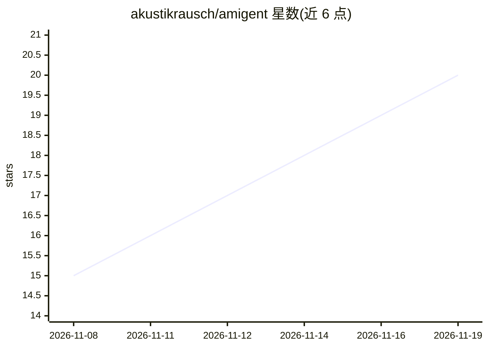

# akustikrausch/amigent

⭐ 20 · Python · MIT · 推送 2026-11-18 · [GitHub](https://github.com/akustikrausch/amigent) · 个人维护

**让 AI agent 远程操控真实 Amiga 电脑的 MCP 服务器与远程桌面**

由 Amiga 端守护进程 amigentd 与 PC/Mac 端程序两部分组成：通过 MCP 服务器让 Claude Code、Codex 等 AI agent 在真实 Amiga 上安装软件、修改设置、复制文件、点击操作程序，同时提供类似 TeamViewer/VNC 的远程桌面（实时屏幕、自有键鼠、文件传输、共享剪贴板），两者可并行且用户可随时接管。针对慢速 Amiga 与慢网络做了传输优化（位平面/调色板分块、增量传输、文本优先读取）。要求 AmigaOS 2.04 以上、68000 起 any CPU，PC 端需 Python 3.10+。

## 筛选速览

| 维度 | 判定 | 备注 |
|---|---|---|
| AI 角色 | `ai-ecosystem` | LLM/agent 周边工具 |
| 许可风险 | `permissive` | MIT |
| 部署形态 | `None` |  |
| 模型依赖 | — | README 未给出锁定关系 |
| 硬件要求 | — | 无带数字的原话,不猜 |
| 安装摩擦 | `low` | 无编译、无系统依赖或容器化 |
| 成熟度 | — | 结构信号不足 |

## 能力要点

- MCP 服务器使 AI agent 可直接操作真实 Amiga（安装软件、改设置、点击程序）
- 远程桌面与 AI 操作可同时进行，用户可随时接管
- 针对慢机器/慢网络的传输优化：增量分块、文本优先、自适应压缩
- 支持安装回滚、多台 Amiga 并排预览（amigent-fleet）、构建调试输出读取

## 适用场景

- 让 AI agent 帮我在真实 Amiga 上安装和更新软件
- 从 PC/Mac 远程桌面操作我的 Amiga 并传文件
- 在 Amiga 上开发程序，让 agent 构建运行并读取调试输出

## 场景标签

`GUI 自动化` · 领域:效率与自动化

## 证据(README 行号)

> L12: - **let an AI agent do the work**, for example Claude Code or Codex: install
> L48:  Install Amigent for me: run "pipx install amigent" (if pipx or Python 3.10
> L51:  the network by itself. Register the MCP server "amigent" with the command

## 星数曲线

2026-11-08 15 → 2026-11-19 20（+5）

---
*卡片 v1 · prompt 1.4 · 生成 2026-11-18 · 置信度 high · 依据 README sha `6dee73836314` · [字段定义](../../DATASET.md)*
