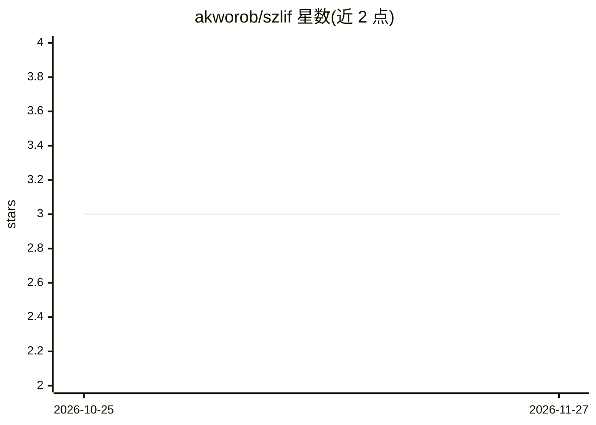

# akworob/szlif

⭐ 3 · Python · MIT · 推送 2026-10-22 · [GitHub](https://github.com/akworob/szlif) · 个人维护

**本地波兰语文本改写与隐藏字符清理工具，Bielik 驱动**

Szlif 是面向波兰语文本的本地工具：调用本机 Ollama 运行的 Bielik 模型逐段改写文本（1-3 轮，可调风格），并清理零宽空格、BOM、同形异码字符等隐藏符号；本地网页以左右对照方式展示每处改动。内置守卫机制，在数字/单位/日期变化、段落长度异常或语气增减时发出警告。明示不承诺绕过 AI 检测器或去除统计水印。仅需 Python 3.9+ 标准库，支持 macOS 与 Windows；清洗功能可脱离模型独立运行。

## 筛选速览

| 维度 | 判定 | 备注 |
|---|---|---|
| AI 角色 | `ai-native` | 本体是模型或模型工具 |
| 许可风险 | `permissive` | MIT |
| 部署形态 | `desktop` | 安装包/桌面程序 |
| 模型依赖 | local-ok | 支持本地模型 |
| 硬件要求 | — | 无带数字的原话,不猜 |
| 安装摩擦 | `low` | 无编译、无系统依赖或容器化 |
| 成熟度 | — | 结构信号不足 |

## 能力要点

- 逐段改写（1-3 轮）与可配置写作风格，基于本地 Ollama 运行的 Bielik
- 隐藏字符清理（零宽空格、BOM、同形字母等），可无模型独立运行
- 守卫机制检测数字/日期丢失、段落长度异常与语气增强/削弱
- 本地网页前后对照展示每处改动，文本默认不出本机

## 适用场景

- 改写波兰语文本并逐处审查改动是否引入或丢失内容
- 清理从 Word/PDF 粘贴文本中的不可见字符
- 对改写结果做数字、日期与语气一致性的核对

## 场景标签

`AI 写作` · 领域:内容生成

## 证据(README 行号)

> L3: > **In English.** Szlif is a small local tool for Polish text. It rewrites a text with the Bielik language model, ru
> L11: - **Przepisywanie Bielikiem.** Akapit po akapicie, w jednej, dwóch albo trzech rundach: rytm zdań, słownictwo, prze

## 星数曲线

2026-10-25 3 → 2026-11-27 3（+0）

---
*卡片 v1 · prompt 1.4 · 生成 2026-11-22 · 置信度 high · 依据 README sha `7afbac178dd5` · [字段定义](../../DATASET.md)*
