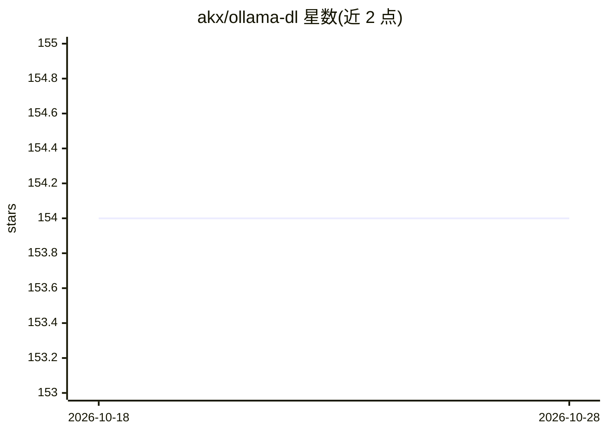

# akx/ollama-dl

⭐ 154 · Python · MIT · 推送 2026-08-12 · [GitHub](https://github.com/akx/ollama-dl) · 个人维护

**免装 Ollama 直接从其模型库下载 GGUF 模型的工具**

Python 命令行脚本，用于从 Ollama 模型库下载模型（GGUF 及模板等文件），无需安装 Ollama 本体。通过 uv 直接运行（自动处理依赖）或在虚拟环境中 pip install -e . 后用 ollama-dl 命令执行，可指定标签下载特定版本。下载完成后文件可配合 llama.cpp 等其他推理工具使用。给需要获取 Ollama 库中模型文件的 Rust/LLM 开发者使用。

## 筛选速览

| 维度 | 判定 | 备注 |
|---|---|---|
| AI 角色 | `ai-ecosystem` | LLM/agent 周边工具 |
| 许可风险 | `permissive` | MIT |
| 部署形态 | `library` | 以包/库形式分发 |
| 模型依赖 | — | README 未给出锁定关系 |
| 硬件要求 | — | 无带数字的原话,不猜 |
| 安装摩擦 | `low` | 无编译、无系统依赖或容器化 |
| 成熟度 | — | 结构信号不足 |

## 能力要点

- 从 Ollama 模型库下载模型，无需安装 Ollama
- 支持按标签下载指定版本（如 llama3.2:1b）
- 可用 uv 一键运行或 pip 安装为 CLI

## 适用场景

- 只想要 Ollama 库里的 GGUF 文件，不想装 Ollama
- 下载模型后交给 llama.cpp 等工具运行
- 批量获取指定版本的模型文件

## 场景标签

 · 领域:LLM 基础设施/模型分发

## 证据(README 行号)

> L3: Downloads models from the Ollama library.
> L16: (If you don't have `uv`, set up a Python virtualenv, `pip install -e .` and run with `ollama-dl`.)

## 星数曲线

2026-10-18 154 → 2026-10-28 154（+0）

---
*卡片 v1 · prompt 1.4 · 生成 2026-10-22 · 置信度 high · 依据 README sha `c15457c0b68e` · [字段定义](../../DATASET.md)*
