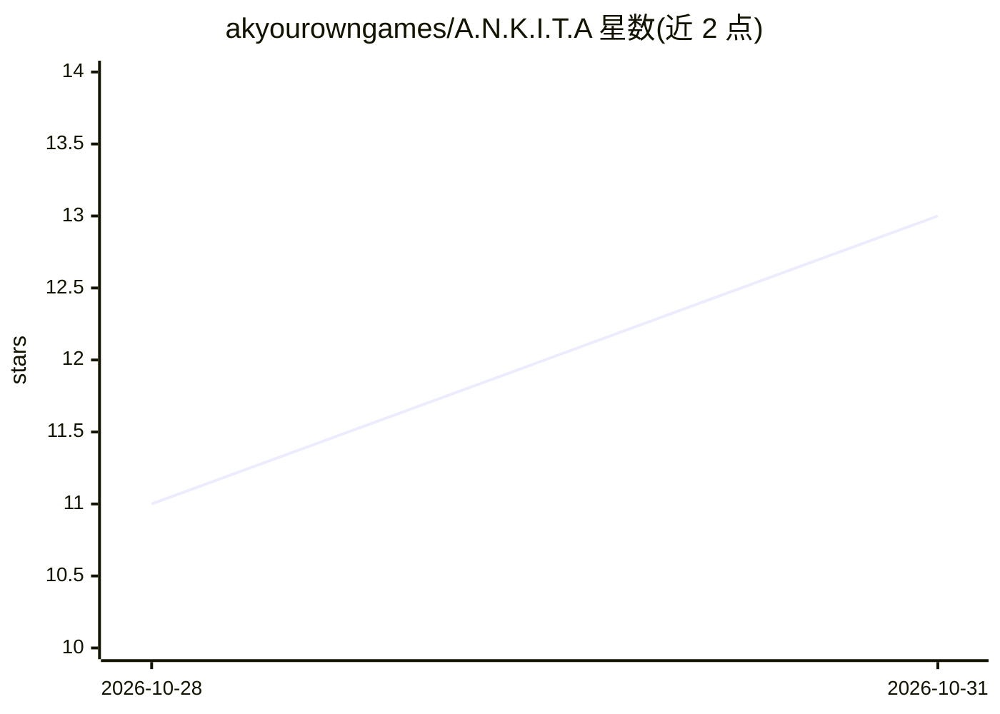

# akyourowngames/A.N.K.I.T.A

⭐ 13 · JavaScript · MIT · 推送 2026-10-30 · [GitHub](https://github.com/akyourowngames/A.N.K.I.T.A) · [官网](https://ankita-sable.vercel.app) · 个人维护

**开源桌面个人 AI 助手：Electron 应用+浮动伴侣+终端 CLI**

Ankita 是运行在 Windows 桌面的个人 AI 工作区，以 Electron 桌面应用、浮动伴侣（floating island）和终端 CLI 三种形态提供，共享同一 agent 运行时与工具集。可执行文件读写编辑、命令与进程管理、Git/HTTP、浏览器操作、定时任务、图像生成、MCP/Composio 接入等工具，命令与文件改动需经审批门。支持 ChatGPT Browser、GitHub Copilot、Groq、Kilo 或 OpenAI 兼容 provider；语音功能需从源码构建。Windows x64 为已验证发布目标。

## 筛选速览

| 维度 | 判定 | 备注 |
|---|---|---|
| AI 角色 | `ai-native` | 本体是模型或模型工具 |
| 许可风险 | `permissive` | MIT |
| 部署形态 | `desktop` | 安装包/桌面程序 |
| 模型依赖 | locked-api |  |
| 硬件要求 | — | 无带数字的原话,不猜 |
| 安装摩擦 | `low` | 无编译、无系统依赖或容器化 |
| 成熟度 | — | 结构信号不足 |

## 能力要点

- 桌面/浮动伴侣/CLI 三形态共享同一 agent 运行时与工具集
- 文件、命令、浏览器、定时任务、MCP/Composio 等工具族与审批门机制
- 多 provider 接入：ChatGPT Browser、GitHub Copilot、Groq、Kilo、OpenAI 兼容
- Hinglish/英语语音委派（源码构建，Sarvam 语音 + Baseten Meta planner）

## 适用场景

- 让 AI 队友检查仓库、编辑文件、跑命令和处理定时任务
- 通过浮动伴侣快速聊天并审批工具操作
- 在终端用 CLI 做交互式编码与后台自动化

## 场景标签

`AI 助手` · 领域:对话与助手

## 证据(README 行号)

> L3: An AI workspace for getting work done on your computer. Ankita brings teammate
> L9: conversation. Choose ChatGPT Browser, GitHub Copilot, Groq, Kilo or an

## 星数曲线

2026-10-28 11 → 2026-10-31 13（+2）

---
*卡片 v1 · prompt 1.4 · 生成 2026-10-31 · 置信度 high · 依据 README sha `88521a55462c` · [字段定义](../../DATASET.md)*
