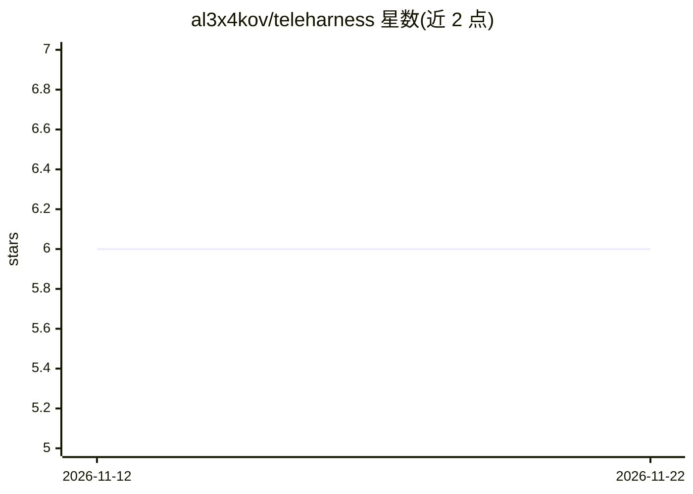

# al3x4kov/teleharness

⭐ — · [GitHub]() · 个人维护 · 中文 README

**自托管控制台：手机上一处操控多个 AI 编码 agent CLI**

一个开源、自托管的 AI 编码 CLI 控制台，在手机优先的 Web UI 中并行运行 Claude Code、Codex 与 opencode，保留各 CLI 已配置的 agents、skills、MCP 服务器与项目上下文。提供跨 CLI 接力（用量限额时手动或自动把会话移交另一引擎）、Temporal 持久化多步流水线（含人工审批步骤）、聊天内审批文件编辑与命令、多用户与配额管理。全部运行在用户已有的 CLI 订阅上，流水线功能可选且仅限 Linux/macOS。

## 筛选速览

| 维度 | 判定 | 备注 |
|---|---|---|
| AI 角色 | `ai-ecosystem` | LLM/agent 周边工具 |
| 许可风险 | `permissive` | — |
| 部署形态 | `library` | 以包/库形式分发 |
| 模型依赖 | — | README 未给出锁定关系 |
| 硬件要求 | — | 无带数字的原话,不猜 |
| 安装摩擦 | `low` | 无编译、无系统依赖或容器化 |
| 成熟度 | — | 结构信号不足 |

## 能力要点

- 一部手机并行聊天 Claude Code、Codex、opencode，保留各自 agents/MCP/skills 配置
- 用量限额时跨 CLI/模型接力会话，支持最多三个备份模型自动移交
- Temporal 流水线串联多步任务，含 Human decision 步骤、计时器、条件与工件
- Obsidian vault 作为活跃缓存，聊天前后写入笔记快照与摘要

## 适用场景

- 出门在外用手机审批编码 agent 的文件编辑与命令
- 订阅用量耗尽时把任务无缝移交给另一个 CLI 继续
- 把审查-审批-写发布说明等流程编排成可重启的流水线
- 团队多用户共享同一自托管实例并各自隔离文件夹

## 场景标签

`多智能体` `编码 Agent` `知识库管理` `工作流自动化` · 领域:Agent 开发

## 证据(README 行号)

> L8: Teleharness is an open-source, self-hosted control room for AI coding CLIs. It runs the real CLIs on your machine —
> L10: chat, approvals from anywhere, cross-CLI handoff and durable multi-agent pipelines on Temporal.
> L94: - **CLIs, not models.** Each chat runs through `opencode serve`, the `claude` CLI or the `codex` CLI. Whatever you

## 星数曲线

2026-11-12 6 → 2026-11-22 6（+0）

---
*卡片 v1 · prompt 1.4 · 生成 2026-11-21 · 置信度 high · 依据 README sha `42400a096513` · [字段定义](../../DATASET.md)*
