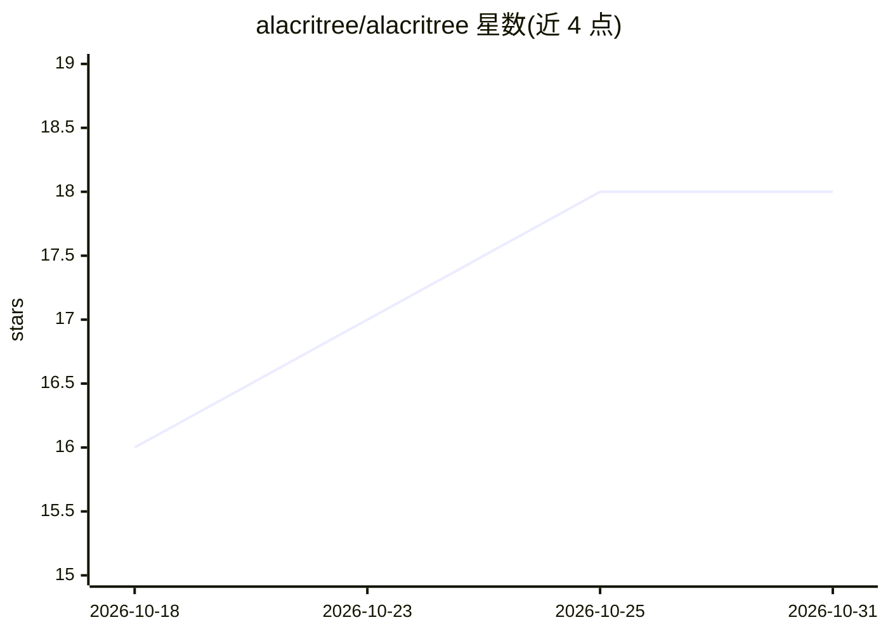

# alacritree/alacritree

⭐ 18 · Rust · Apache-2.0 · 推送 2026-10-30 · [GitHub](https://github.com/alacritree/alacritree) · 个人维护

**把 Git worktree 变成工作区的原生终端（Alacritty 分叉）**

基于 Alacritty 的原生终端分叉，围绕 Git worktree 提供项目侧栏、每工作区独立会话、Git 状态面板、工作区 Markdown 草稿板等能力，兼容 alacritty.toml 配置。为 AI agent 设计：新 worktree 复制 CLAUDE.md/AGENTS.md/.cursor/ 等助手配置，草稿板可经 MCP 被 agent 读取，内置 stdio MCP 服务器与 CLI 供 agent 列项目、开会话、输入与读屏；不捆绑 agent、无遥测。提供 Linux/macOS/Windows 发布包、AUR/brew/scoop/脚本安装及源码编译，Windows 支持 WSL 项目。

## 筛选速览

| 维度 | 判定 | 备注 |
|---|---|---|
| AI 角色 | `ai-enhanced` | 去掉 AI 部分产品仍成立 |
| 许可风险 | `permissive` | Apache-2.0 |
| 部署形态 | `desktop` | 安装包/桌面程序 |
| 模型依赖 | — | README 未给出锁定关系 |
| 硬件要求 | — | 无带数字的原话,不猜 |
| 安装摩擦 | `medium` | 含编译或系统依赖之一 |
| 成熟度 | — | 结构信号不足 |

## 能力要点

- Git worktree 一级工作区：侧栏管理、每工作区独立终端会话
- stdio MCP 服务器 + CLI，agent 可创建 worktree、向终端输入并读取屏幕
- 新 worktree 自动复制 CLAUDE.md/AGENTS.md/.cursor/ 等 AI 助手配置
- 工作区草稿板 Markdown 编辑器，agent 经 MCP 读取

## 适用场景

- 在多个 worktree 间切换并保持各自的终端会话
- 让 LLM agent 经 MCP 控制终端：开会话、输入命令、读输出、查 Git 状态
- 多分支并行开发时保持各分支的 AI 助手配置一致

## 场景标签

 · 领域:开发者工具/终端

## 证据(README 行号)

> L5:  A native terminal that turns Git worktrees into first-class workspaces, built on Alacritty.
> L18: - **Scriptable.** An MCP server and a CLI create worktrees, open sessions, type into them and read their screens fr
> L20: No Chromium, no bundled agents, no telemetry. No company behind it, and there never will be.

## 星数曲线

2026-10-18 16 → 2026-10-31 18（+2）

---
*卡片 v1 · prompt 1.4 · 生成 2026-10-29 · 置信度 high · 依据 README sha `6cceaf9c7d1d` · [字段定义](../../DATASET.md)*
