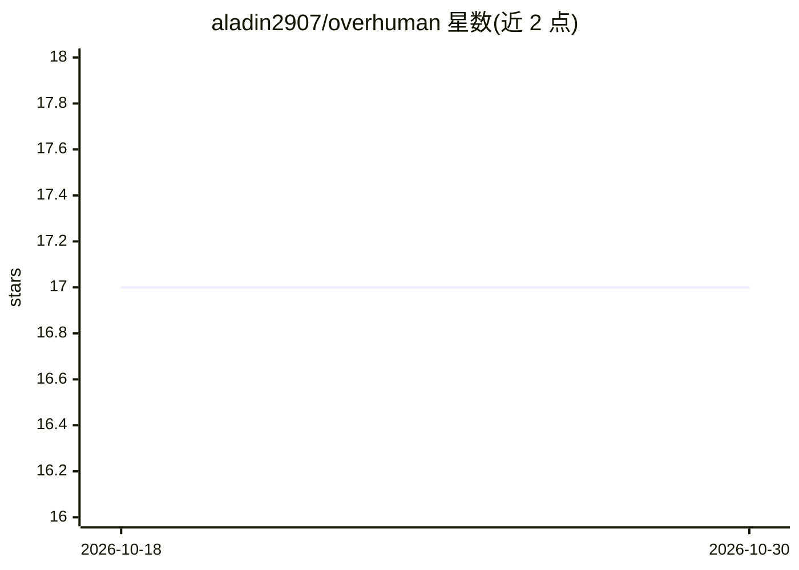

# aladin2907/overhuman

⭐ 17 · Go · MIT · 推送 2026-04-09 · [GitHub](https://github.com/aladin2907/overhuman) · 个人维护

**Go 编写的自进化 AI 常驻守护进程，每次回答生成全新界面**

用 Go 实现的 always-on AI 守护进程：请求经过 10 阶段流水线处理，由 LLM 为每次回答从零生成 HTML/ANSI 界面（非模板、无组件库），渲染于终端、浏览器或 Kiosk 全屏显示。支持 OpenAI、Claude、Ollama、Groq、Together、OpenRouter 等多种 LLM 提供方，含 SQLite 长短期记忆、4 级反思、任务重复 3 次自动生成代码技能替代 LLM 调用、分形 agent 树与 MCP 工具接入。以单个 Go 二进制分发，可作为 launchd/systemd 系统服务运行，本地零配置模式可用 Ollama。

## 筛选速览

| 维度 | 判定 | 备注 |
|---|---|---|
| AI 角色 | `ai-native` | 本体是模型或模型工具 |
| 许可风险 | `permissive` | MIT |
| 部署形态 | `None` |  |
| 模型依赖 | local-ok | 支持本地模型 |
| 硬件要求 | — | 无带数字的原话,不猜 |
| 安装摩擦 | `low` | 无编译、无系统依赖或容器化 |
| 成熟度 | — | 结构信号不足 |

## 能力要点

- LLM 为每次回答从零生成完整 UI（终端/浏览器/Kiosk 三种渲染目标）
- 10 阶段流水线 + 4 级反思（Micro/Meso/Macro/Mega）自改进
- 任务重复 3 次自动生成代码技能替代 LLM 调用
- 6 种输入通道：CLI、Telegram、Slack、Discord、Email、HTTP API

## 适用场景

- 在桌面/平板/挂墙屏幕上常驻一个生成式界面的 AI 助手
- 通过 Telegram/Slack/Discord/Email 等通道向守护进程提交任务
- 本地零配置模式用 Ollama 免 API key 运行

## 场景标签

`AI 助手` · 领域:对话与助手

## 证据(README 行号)

> L8:  Overhuman is an always-on AI daemon that processes tasks through a 10-stage pipeline
> L25: Most AI assistants return plain text. Some pick from pre-built component catalogs. **Overhuman generates complete U
> L107: Every request passes through the full 10-stage pipeline. Stages 7-9 feed back into the system — this is how Overhu

## 星数曲线

2026-10-18 17 → 2026-10-30 17（+0）

---
*卡片 v1 · prompt 1.4 · 生成 2026-10-29 · 置信度 high · 依据 README sha `1304274c0fd7` · [字段定义](../../DATASET.md)*
