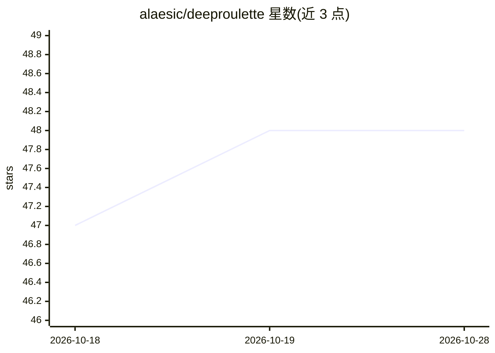

# alaesic/deeproulette

⭐ 48 · Python · Apache-2.0 · 推送 2026-04-03 · [GitHub](https://github.com/alaesic/deeproulette) · 个人维护

**轮盘赌结果预测器：Transformer+BiLSTM 实时预测下注**

面向轮盘赌玩家的 AI 预测工具：以最近 15 次旋转结果为输入，通过 Transformer 注意力块 + 双向 LSTM 栈 + 全连接头输出 37 个号码的概率分布，支持手动输入、模拟与 WebSocket 实时直播桌台三种数据模式。提供 10 种下注策略（内部/外部/AI 自适应），可选在线学习（每 150 次结果更新模型），Rich 终端交互菜单。Windows 提供 EXE 安装包（约 400-700MB，内置 TensorFlow），Linux/macOS 从源码运行（要求 Python 3.10）。README 明确声明仅供教育研究用途且轮盘为纯随机游戏。

## 筛选速览

| 维度 | 判定 | 备注 |
|---|---|---|
| AI 角色 | `ai-native` | 本体是模型或模型工具 |
| 许可风险 | `permissive` | Apache-2.0 |
| 部署形态 | `desktop` | 安装包/桌面程序 |
| 模型依赖 | — | README 未给出锁定关系 |
| 硬件要求 | — | 无带数字的原话,不猜 |
| 安装摩擦 | `low` | 无编译、无系统依赖或容器化 |
| 成熟度 | — | 结构信号不足 |

## 能力要点

- Transformer + BiLSTM 输出 37 号码概率分布
- WebSocket 实时桌台数据接入与自动重连
- 手动/模拟/直播三种模式各配独立模型目录
- 可选在线学习：每旋转后用最近 150 局更新模型

## 适用场景

- 我想在终端里观察 AI 对轮盘结果的概率预测
- 研究序列模型在随机事件上的学习行为
- 模拟或手动输入历史数据测试不同下注策略

## 场景标签

 · 领域:AI 预测/桌面工具

## 证据(README 行号)

> L5:  Transformer + BiLSTM roulette predictor real-time learning, inside & outside bets, works with any table.
> L118: - **Architecture**: Transformer attention block + bidirectional LSTM stack + dense head
> L120: - **Output**: Probability distribution over all 37 numbers (0–36)

## 星数曲线

2026-10-18 47 → 2026-10-28 48（+1）

---
*卡片 v1 · prompt 1.4 · 生成 2026-10-25 · 置信度 high · 依据 README sha `02bd145033f3` · [字段定义](../../DATASET.md)*
