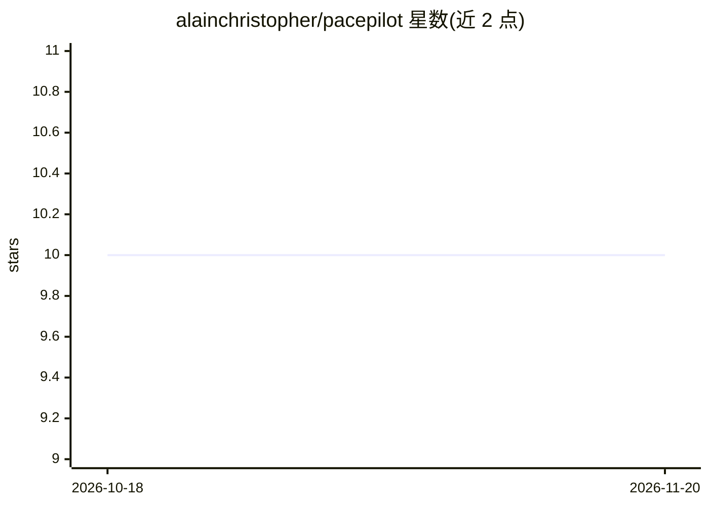

# alainchristopher/pacepilot

⭐ 10 · Kotlin · MIT · 推送 2026-07-03 · [GitHub](https://github.com/alainchristopher/pacepilot) · 个人维护

**面向 Hammerhead Karoo 骑行码表的实时 AI 骑行教练扩展**

以 Karoo 原生扩展形式运行的应用：实时读取功率、心率、踏频等遥测数据，检测骑行类型，通过 InRideAlert 推送教练提示。采用混合架构——规则引擎（45+ 条规则、6 种骑行模式）离线即时触发，可选 AI 层（Gemini 2.0 Flash 或 Mercury-2）基于 30 次骑行历史异步升级提示文案；支持赛前在 Wi-Fi 下生成离线提示库、铁三 Race Mode、多语言提示、赛后分析脚本。规则部分无需 API key，AI 层需 API key 与网络。

## 筛选速览

| 维度 | 判定 | 备注 |
|---|---|---|
| AI 角色 | `ai-native` | 本体是模型或模型工具 |
| 许可风险 | `permissive` | MIT |
| 部署形态 | `desktop` | 安装包/桌面程序 |
| 模型依赖 | — | README 未给出锁定关系 |
| 硬件要求 | — | 无带数字的原话,不猜 |
| 安装摩擦 | `low` | 无编译、无系统依赖或容器化 |
| 成熟度 | — | 结构信号不足 |

## 能力要点

- 规则引擎离线可用，45+ 条教练规则覆盖 6 种骑行模式
- 可选 AI 层异步升级提示文案，Gemini 2.0 Flash 上下文缓存约 $0.01/次骑行
- 赛前生成 80–120 条个性化离线提示库，赛日无网络仍可使用
- 铁三 Race Mode：功率区间、跑段保护、负分段与终点提示

## 适用场景

- 公路骑行/训练时实时获得功率与心率区间的教练提示
- 铁人三项自行车段按目标功率与补给节奏执行比赛计划
- 无手机热点的比赛日使用离线个性化提示库
- 骑行结束后生成体能分析报告

## 场景标签

 · 领域:运动健身/骑行

## 证据(README 行号)

> L3: Real-time coaching alerts during your ride, powered by rules + optional AI. Built as a native Karoo extension using 
> L34: **AI layer** (optional, needs API key + internet during ride):

## 星数曲线

2026-10-18 10 → 2026-11-20 10（+0）

---
*卡片 v1 · prompt 1.4 · 生成 2026-11-20 · 置信度 mid · 依据 README sha `e6160de7cf17` · [字段定义](../../DATASET.md)*
