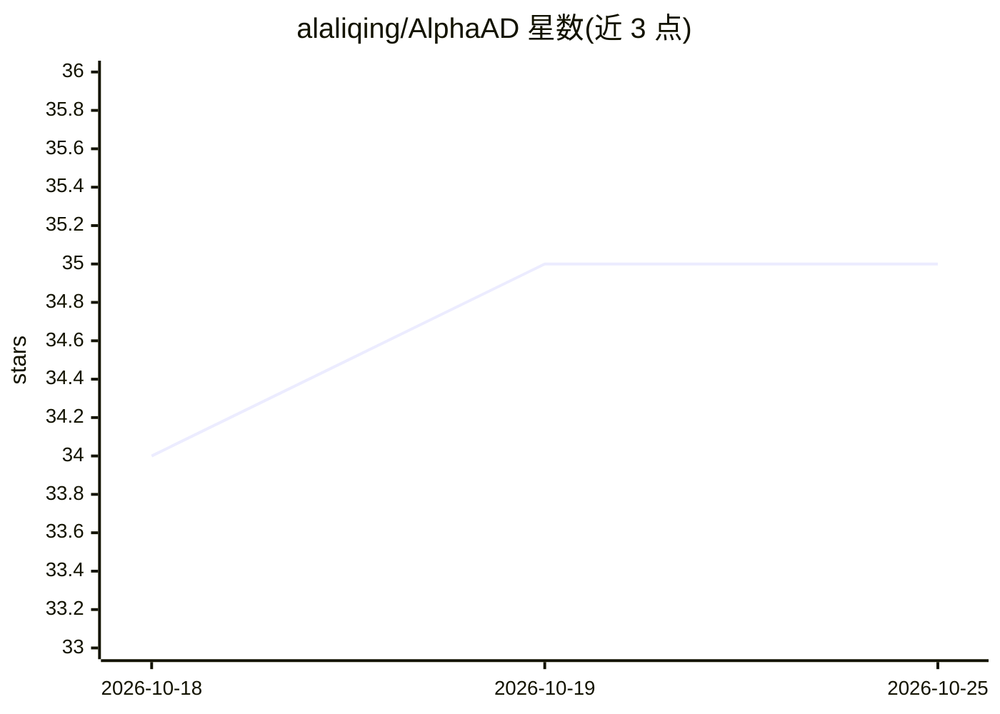

# alaliqing/AlphaAD

⭐ 35 · HTML · MIT · 推送 2026-10-25 · [GitHub](https://github.com/alaliqing/AlphaAD) · [官网](https://alaliqing.github.io/AlphaAD/) · 个人维护

**自动驾驶 arXiv 论文日更清单：分类浏览最新研究**

自动聚合 arXiv 自动驾驶领域最新论文的策展清单：收录 1,417 篇论文，按感知与传感器融合、预测与世界模型、规划决策、控制、端到端与 VLA、安全验证等 10 个主题分类组织，每篇论文给出作者、发布日期、研究标签、arXiv 摘要与 PDF 链接；另提供 Dataset、Benchmark、Simulation、VLA 等 13 种方法/资源标签用于细化筛选，以及支持全文搜索与过滤的交互式索引页面。每日自动更新。

## 筛选速览

| 维度 | 判定 | 备注 |
|---|---|---|
| AI 角色 | `ai-knowledge` | 知识聚合/清单类 |
| 许可风险 | `permissive` | MIT |
| 部署形态 | `None` |  |
| 模型依赖 | — | README 未给出锁定关系 |
| 硬件要求 | — | 无带数字的原话,不猜 |
| 安装摩擦 | `low` | 无编译、无系统依赖或容器化 |
| 成熟度 | — | 结构信号不足 |

## 能力要点

- 收录 1,417 篇自动驾驶论文，按 10 个主题分类
- 13 种方法/资源标签（Dataset/Benchmark/Simulation/VLA 等）可用于筛选
- 每篇条目含作者、日期、标签、arXiv 摘要与 PDF 链接
- 每日自动更新，并提供交互式研究索引支持全文搜索

## 适用场景

- 追踪自动驾驶各方向的最新 arXiv 论文
- 按数据集、基准、仿真等标签查找所需资源类型的论文
- 浏览某一主题（如感知、安全验证）下的论文列表

## 场景标签

`精选清单` · 领域:学习与行业

## 证据(README 行号)

> L1: # 🚗 AlphaAD · Autonomous Driving Research
> L8: **A daily, explainable research signal for autonomous driving.**

## 星数曲线

2026-10-18 34 → 2026-10-25 35（+1）

---
*卡片 v1 · prompt 1.4 · 生成 2026-10-25 · 置信度 high · 依据 README sha `8cf238ff8da4` · [字段定义](../../DATASET.md)*
