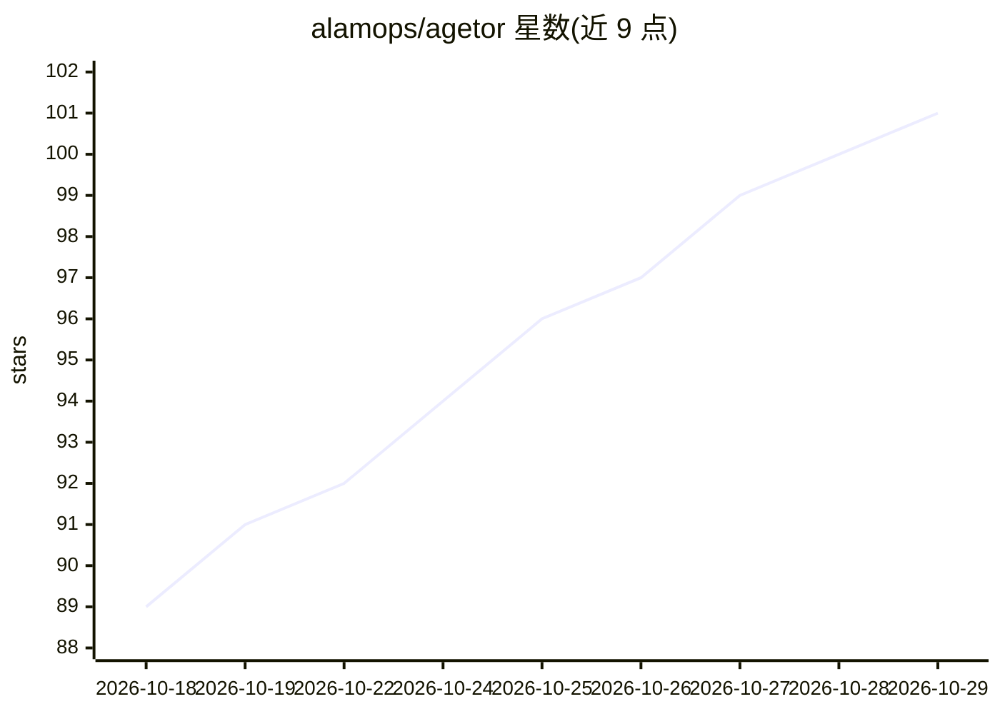

# alamops/agetor

⭐ 101 · TypeScript · MIT · 推送 2026-10-28 · [GitHub](https://github.com/alamops/agetor) · [官网](https://agetor.dev) · 个人维护

**本地优先看板：并行运行多个 CLI 编码 agent 的编排器**

面向使用 Claude Code、Codex、Cursor 等 CLI 编码 agent 的开发者的本地看板应用：每个任务自动创建隔离 git worktree，在 tmux 中启动各 agent 自带 CLI 并流式呈现结构化对话；支持六种 harness、可复用 Agent 配置、多步 Pipeline 图、diff 审查、GitHub/GitLab/Bitbucket 集成与配额统计。本地运行、无账户无遥测、不安装钩子。以 macOS（Apple Silicon）桌面应用与 CLI 二进制分发，Linux/Windows 未构建。

## 筛选速览

| 维度 | 判定 | 备注 |
|---|---|---|
| AI 角色 | `ai-ecosystem` | LLM/agent 周边工具 |
| 许可风险 | `permissive` | MIT |
| 部署形态 | `desktop` | 安装包/桌面程序 |
| 模型依赖 | — | README 未给出锁定关系 |
| 硬件要求 | — | 无带数字的原话,不猜 |
| 安装摩擦 | `low` | 无编译、无系统依赖或容器化 |
| 成熟度 | `idea` | |

## 能力要点

- 每任务独立 git worktree，多 agent 可并行操作同一仓库
- 六种 harness：Claude Code、Codex、Cursor、Gemini CLI、fx、Antigravity
- Pipeline 将多个 Agent 串成可复用图，步骤间以 handoff JSON 交接上下文
- tmux 承载 agent 会话，退出 Agetor 不中断，重启后重连

## 适用场景

- 我同时在多个仓库或分支上跑多个编码 agent
- 用看板追踪 agent 任务的阻塞、审批与评审状态
- 把 规划→实现→评审 组成可复用的流水线

## 场景标签

`多智能体` · 领域:Agent 开发

## 证据(README 行号)

> L20: Coding agents are good enough now that the limiting factor is you: one terminal, one conversation, one branch at a 
> L22: **Agetor doesn't replace your agents, and it doesn't replace your harness.** Claude Code is still Claude Code, with
> L61: A **harness** is the agent CLI Agetor drives. Agetor launches the real binary on your `PATH` with your existing log

## 星数曲线

2026-10-18 89 → 2026-10-29 101（+12）

---
*卡片 v1 · prompt 1.4 · 生成 2026-10-23 · 置信度 mid · 依据 README sha `05f412a8c8cb` · [字段定义](../../DATASET.md)*
