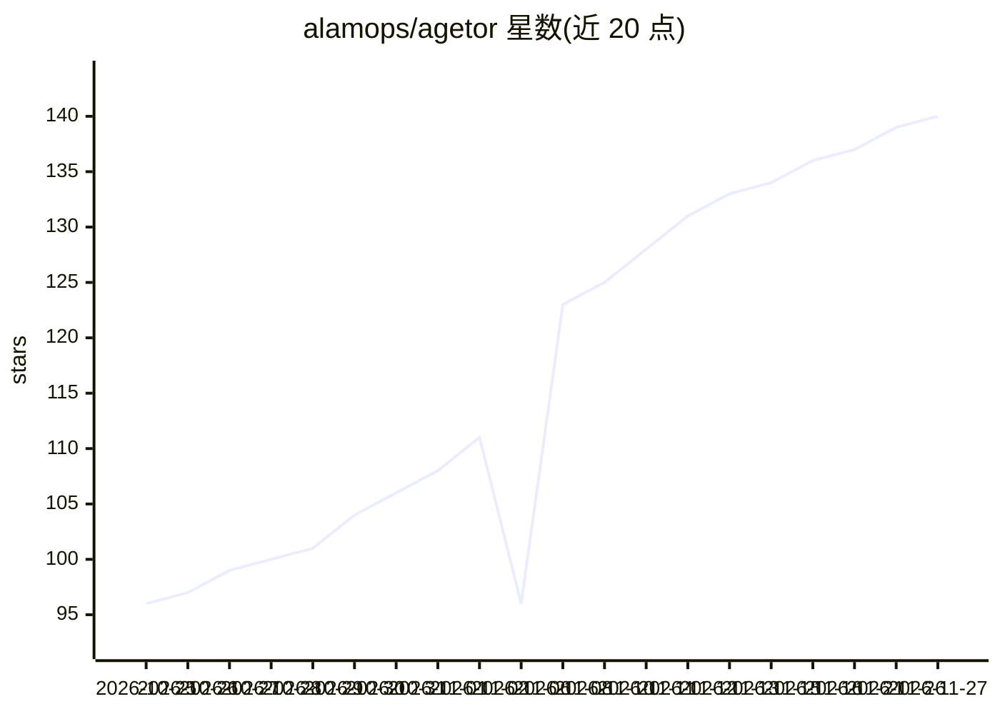

# alamops/agetor

⭐ 140 · TypeScript · MIT · 推送 2026-11-26 · [GitHub](https://github.com/alamops/agetor) · [官网](https://agetor.dev) · 个人维护

**为并行运行 Claude Code 等 CLI 编码 agent 提供看板编排**

本地优先的看板应用，把用户已有的编码 agent CLI 纳入统一控制面：每张任务卡对应一个 prompt、仓库与 harness，运行时自动创建隔离的 git worktree 并在 tmux 中启动 agent 原生 CLI，输出以结构化组件流式展示。支持 8 种 harness 的多账号堆叠与配额耗尽自动切换，可把多个 Agent 编排为 Pipeline 图。基于 Bun 构建，桌面应用自带更新与原生通知；不含云端中继与遥测。部分 harness 标注为 experimental。

## 筛选速览

| 维度 | 判定 | 备注 |
|---|---|---|
| AI 角色 | `ai-ecosystem` | LLM/agent 周边工具 |
| 许可风险 | `permissive` | MIT |
| 部署形态 | `desktop` | 安装包/桌面程序 |
| 模型依赖 | locked-api |  |
| 硬件要求 | — | 无带数字的原话,不猜 |
| 安装摩擦 | `low` | 无编译、无系统依赖或容器化 |
| 成熟度 | — | 结构信号不足 |

## 能力要点

- 每任务独立 git worktree，支持同仓库多 agent 并行
- 8 种 harness（Claude Code/Codex/Cursor 等）同板运行，运行时发现各 CLI 可用模型
- 多账号堆叠：配额耗尽时同会话续接到备用账号
- Pipeline 将 Agent 串成可复用图（分支/扇出/循环）

## 适用场景

- 在一张看板上并行推进多个仓库的编码任务
- 为同一 harness 配置多个账号并在限流时自动续跑
- 把 Plan→Implement→Review 流程固化为 Pipeline

## 场景标签

`编码 Agent` `多智能体` · 领域:Agent 开发

## 证据(README 行号)

> L5: **The harness orchestrator.**
> L6: A local-first kanban for running Claude Code, Codex, Cursor, Gemini CLI, fx, Antigravity, GitHub Copilot and OpenCod
> L62: A **harness** is the agent CLI Agetor drives. Agetor launches the real binary on your `PATH` with your existing log

## 星数曲线

2026-10-25 96 → 2026-11-27 140（+44）

---
*卡片 v1 · prompt 1.4 · 生成 2026-11-27 · 置信度 mid · 依据 README sha `e4b1e85f735d` · [字段定义](../../DATASET.md)*
