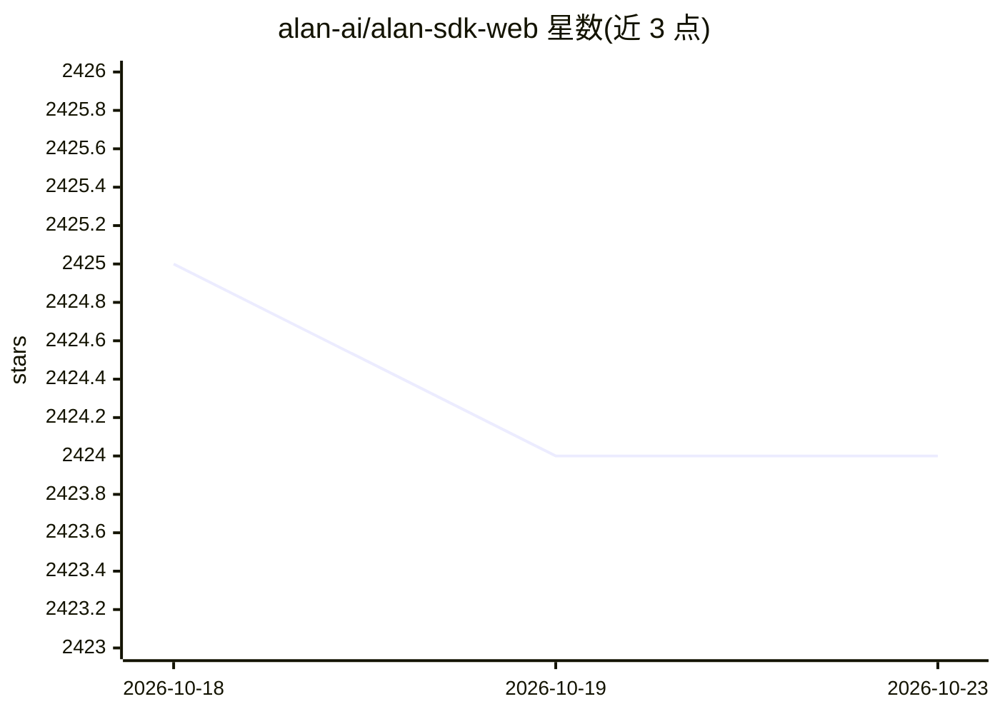

# alan-ai/alan-sdk-web

⭐ 2,424 · 推送 2026-09-14 · [GitHub](https://github.com/alan-ai/alan-sdk-web) · [官网](https://alan.app/) · 组织维护

**将 Alan AI 生成式智能体嵌入 Web 应用的官方 SDK**

Alan AI 公司发布的 Web 端 SDK，用于把 Alan AI 平台（自称基于 Three-Layer AI 架构、可在运行时生成业务逻辑与 UI 的'自编码'层）生成的 Generative AI Agent 嵌入 Web 应用。工作流程：先在 Alan AI Studio 注册并用 JavaScript 编写对话脚本，再通过本 SDK 集成到应用；支持 JavaScript/React/Angular/Vue/Ember/Electron，通过 npm 分发，另提供 iOS/Android/Flutter 等其他平台 SDK。依赖 Alan AI 云端平台与账号。

## 筛选速览

| 维度 | 判定 | 备注 |
|---|---|---|
| AI 角色 | `ai-ecosystem` | LLM/agent 周边工具 |
| 许可风险 | `none` | — |
| 部署形态 | `None` |  |
| 模型依赖 | — | README 未给出锁定关系 |
| 硬件要求 | — | 无带数字的原话,不猜 |
| 安装摩擦 | `low` | 无编译、无系统依赖或容器化 |
| 成熟度 | — | 结构信号不足 |

## 能力要点

- 以 npm 包形式提供，面向多种 Web 前端框架
- 提供 React/Angular/Vue/Ember/Electron 示例应用
- 对话框脚本在 Alan AI Studio 中以 JavaScript 编写

## 适用场景

- 为自己的网站或 Web 应用添加 Alan AI 对话智能体
- 在 React/Vue/Electron 等框架中嵌入 Alan AI 按钮
- 参考官方示例工程了解 SDK 接入方式

## 场景标签

`AI 助手` `聊天机器人` · 领域:对话与助手

## 证据(README 行号)

> L21: This repository contains the **Alan AI SDK for Web**, enabling you to embed Alan's intelligent layer into your Web 
> L27: 1. Sign up for Alan AI Studio to build dialog scripts in JavaScript and test them.
> L28: 2. Use the Alan AI SDK for Web to embed a Generative AI Agent to your app or website. For details, see Alan AI docu

## 星数曲线

2026-10-18 2,425 → 2026-10-23 2,424（-1）

---
*卡片 v1 · prompt 1.4 · 生成 2026-10-21 · 置信度 high · 依据 README sha `ce5eb5276fd0` · [字段定义](../../DATASET.md)*
