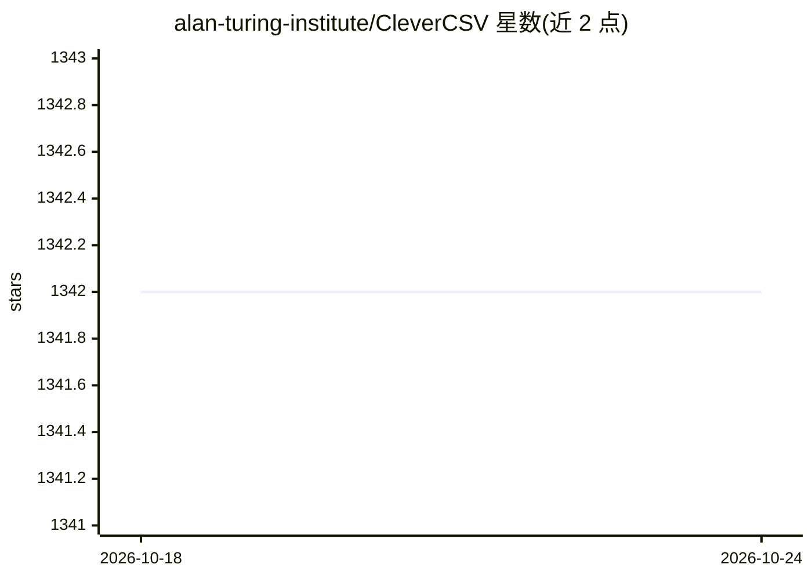

# alan-turing-institute/CleverCSV

⭐ 1,342 · Python · MIT · 推送 2026-08-10 · [GitHub](https://github.com/alan-turing-institute/CleverCSV) · [官网](https://clevercsv.readthedocs.io) · 组织维护

**处理混乱 CSV 的 Python 库：自动检测方言并标准化文件**

由 Alan Turing Institute 维护的 Python 包，提供内置 csv 模块的替换品，自动检测混乱 CSV 文件的方言（分隔符、引号、转义符）。检测方法基于对数千个真实 CSV 文件的研究，利用解析后行长度模式与单元格数据类型模式判定，论文报告 97% 检测准确率。附带命令行工具，支持查看文件、生成导入代码、按 RFC-4180 标准化文件，并提供 pre-commit 钩子防止提交非标准 CSV。核心包无第三方依赖，完整版含命令行工具。

## 筛选速览

| 维度 | 判定 | 备注 |
|---|---|---|
| AI 角色 | `ai-enhanced` | 去掉 AI 部分产品仍成立 |
| 许可风险 | `permissive` | MIT |
| 部署形态 | `library` | 以包/库形式分发 |
| 模型依赖 | — | README 未给出锁定关系 |
| 硬件要求 | — | 无带数字的原话,不猜 |
| 安装摩擦 | `low` | 无编译、无系统依赖或容器化 |
| 成熟度 | — | 结构信号不足 |

## 能力要点

- 内置 csv 模块的替换品，自动检测方言与编码
- 提供 read_table/read_dataframe/read_dicts 等辅助函数及流式版本
- 命令行工具支持 code/detect/explore/standardize/view 命令
- pre-commit 钩子在提交时自动按 RFC-4180 标准化 CSV

## 适用场景

- 加载格式不明的混乱 CSV 文件时免去人工检查方言
- 把非标准 CSV 统一改写为 RFC-4180 标准
- 为数据管道生成带正确方言的 Python 导入代码

## 场景标签

 · 领域:数据处理/数据清洗

## 证据(README 行号)

> L20: *CleverCSV provides a drop-in replacement for the Python* ``csv`` *package
> L85: dialect will give you *some* table. In CleverCSV we use a technique based on
> L87: resulting cells. With our method we achieve 97% accuracy for dialect

## 星数曲线

2026-10-18 1,342 → 2026-10-24 1,342（+0）

---
*卡片 v1 · prompt 1.4 · 生成 2026-10-21 · 置信度 mid · 依据 README sha `446d2c310886` · [字段定义](../../DATASET.md)*
