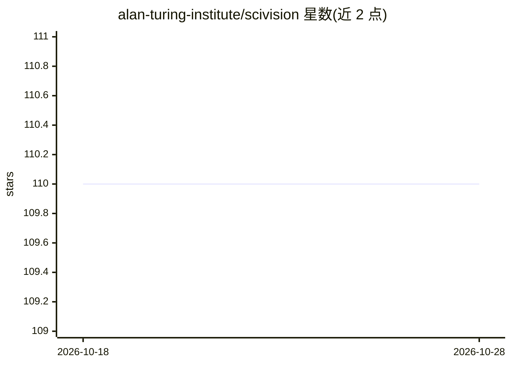

# alan-turing-institute/scivision

⭐ 110 · JavaScript · BSD-3-Clause · 推送 2026-10-27 · [GitHub](https://github.com/alan-turing-institute/scivision) · [官网](https://alan-turing-institute.github.io/scivision/) · 组织维护

**科研图像计算机视觉模型与数据集目录及 Python 加载框架**

由 Alan Turing Institute 发起的科研项目，包含三部分：科研与人文领域计算机视觉从业者社区、社区策划的 CV 模型与数据集目录，以及互操作工具生态。核心是 Scivision.Py Python 包：从目录按名称加载预训练模型与数据源，接受 numpy 兼容图像输入执行预测（示例为 ResNet18 图像分类），模型/数据目录以 Pandas dataframe 形式查询；另有 Pixelflow 工具用于提取图像中物体特征。模型与数据条目通过网站提交收录。

## 筛选速览

| 维度 | 判定 | 备注 |
|---|---|---|
| AI 角色 | `ai-ecosystem` | LLM/agent 周边工具 |
| 许可风险 | `permissive` | BSD-3-Clause |
| 部署形态 | `library` | 以包/库形式分发 |
| 模型依赖 | — | README 未给出锁定关系 |
| 硬件要求 | — | 无带数字的原话,不猜 |
| 安装摩擦 | `low` | 无编译、无系统依赖或容器化 |
| 成熟度 | — | 结构信号不足 |

## 能力要点

- load_pretrained_model / load_dataset 从目录加载 CV 模型与数据源
- 模型与数据目录可在线浏览并以 Pandas dataframe 查询
- pip 安装，图像输入兼容任意 numpy Array_like 数据
- 收录 stardist、PlantCV 等科研图像分析模型

## 适用场景

- 科研/人文领域图像分析任务中查找适用的 CV 模型与数据集
- 在 Python 中按目录名称直接加载并运行预训练模型
- 浏览社区策划的科学图像模型与数据源清单

## 场景标签

`科研工具` · 领域:学习与行业

## 证据(README 行号)

> L14: - A **catalog** of community-curated computer vision models and datasets from the sciences and humanities
> L16:  - **Scivision.Py**, a Python package for conveniently downloading and using the computer vision models and dataset

## 星数曲线

2026-10-18 110 → 2026-10-28 110（+0）

---
*卡片 v1 · prompt 1.4 · 生成 2026-10-23 · 置信度 high · 依据 README sha `481f6472615d` · [字段定义](../../DATASET.md)*
