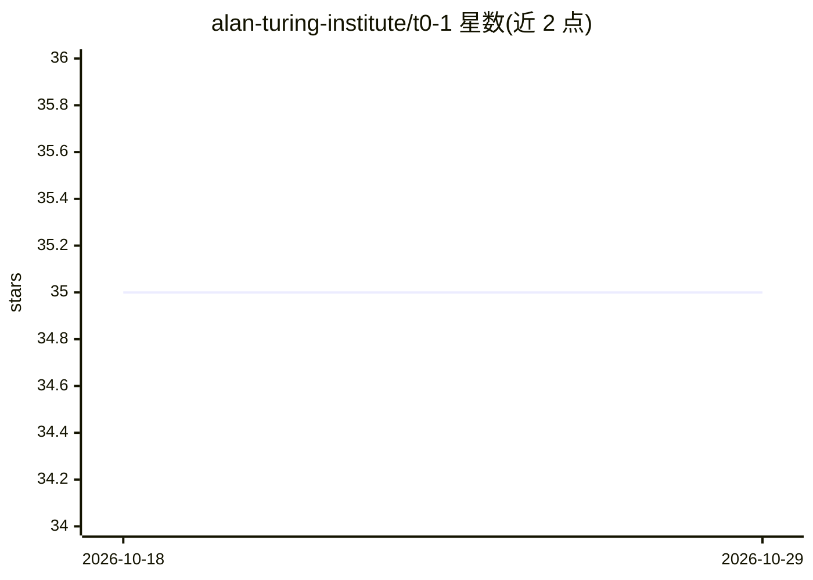

# alan-turing-institute/t0-1

⭐ 35 · Jupyter Notebook · MIT · 推送 2026-08-25 · [GitHub](https://github.com/alan-turing-institute/t0-1) · 组织维护

**在 NHS 医学知识库上演示检索增强推理的 RAG 工具集**

Alan Turing Institute t0 研究计划的示例仓库：以 NHS A to Z 病症网页为领域语料，提供数据抓取与 JSONL 生成脚本、向量库构建（chroma/faiss，含持久化）、检索器与 RAG 模型的 FastAPI 服务封装及查询 CLI。LLM 后端可选 Hugging Face 本地模型或 Azure OpenAI，模型端点可经 vLLM 部署（t0-1.1-k5-32B、Qwen2.5-32B-Instruct）。另含向量库评测命令，按检索命中目标文档计分。

## 筛选速览

| 维度 | 判定 | 备注 |
|---|---|---|
| AI 角色 | `ai-ecosystem` | LLM/agent 周边工具 |
| 许可风险 | `permissive` | MIT |
| 部署形态 | `library` | 以包/库形式分发 |
| 模型依赖 | local-ok | 支持本地模型 |
| 硬件要求 | — | 无带数字的原话,不猜 |
| 安装摩擦 | `low` | 无编译、无系统依赖或容器化 |
| 成熟度 | — | 结构信号不足 |

## 能力要点

- 向量库/检索器/RAG 三层 FastAPI 服务与对应查询 CLI（typer 实现）
- 支持 chroma 与 faiss 向量库，可持久化保存与加载
- LLM 后端可选 Hugging Face 或 Azure OpenAI，模型经 vLLM 端点服务
- 向量库评测命令按 top-k 命中目标文档计分

## 适用场景

- 在 NHS 病症语料上搭建并查询 RAG 问答服务
- 评测向量库检索是否命中目标文档
- 参考其结构搭建其他领域知识的检索增强服务

## 场景标签

`RAG` · 领域:知识与检索

## 证据(README 行号)

> L5: In this repo, we provide an exemplary application of Retrieval-Augmented Reasoning on a domain-specific body of know
> L48: - scripts/serve_rag_conversational.sh: This sets up an endpoint for the RAG model and serves it using FastAPI
> L195: Many options are similar to the vector store and retriever serving commands which are described above. The main di

## 星数曲线

2026-10-18 35 → 2026-10-29 35（+0）

---
*卡片 v1 · prompt 1.4 · 生成 2026-10-25 · 置信度 mid · 依据 README sha `87811932c2bf` · [字段定义](../../DATASET.md)*
