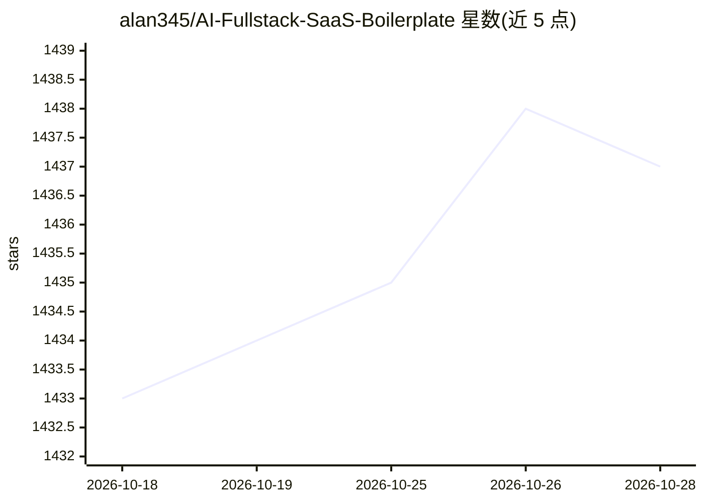

# alan345/AI-Fullstack-SaaS-Boilerplate

⭐ 1,437 · TypeScript · MIT · 推送 2026-10-27 · [GitHub](https://github.com/alan345/AI-Fullstack-SaaS-Boilerplate) · [官网](https://alan345.github.io/AI-Fullstack-SaaS-Boilerplate/) · 个人维护

**基于 Fastify/tRPC/React 的全栈 SaaS 脚手架，含 AI 聊天**

面向开发者的全栈 SaaS 应用模板：后端 Fastify + tRPC，前端 React 19 + Tailwind v4，数据库 Postgres 配 Drizzle ORM，认证用 Better Auth。功能含外部 REST API 数据拉取、服务端健康检查、防抖搜索、基于 Server-Sent Events 的聊天（依赖 OpenAI API）。以 pnpm monorepo 形式提供，需配置 .env 与运行中的 Postgres；不使用 Next.js，前端保持静态文件形态，定位为构建 Web 应用而非 SEO 友好的网站。

## 筛选速览

| 维度 | 判定 | 备注 |
|---|---|---|
| AI 角色 | `ai-ecosystem` | LLM/agent 周边工具 |
| 许可风险 | `permissive` | MIT |
| 部署形态 | `library` | 以包/库形式分发 |
| 模型依赖 | — | README 未给出锁定关系 |
| 硬件要求 | — | 无带数字的原话,不猜 |
| 安装摩擦 | `low` | 无编译、无系统依赖或容器化 |
| 成熟度 | — | 结构信号不足 |

## 能力要点

- Fastify + tRPC 端到端类型安全 API
- 基于 SSE 的聊天功能，无需 WebSocket 服务器
- Better Auth 认证与 Drizzle ORM + Postgres 数据层
- pnpm Workspaces monorepo 结构，附 Playwright E2E 测试

## 适用场景

- 以此为起点快速搭建全栈 SaaS Web 应用
- 获得类型安全的前后端一体化项目结构
- 运行 SSE 聊天与外部 API 集成的参考实现

## 场景标签

 · 领域:Web 开发/SaaS 模板

## 证据(README 行号)

> L44: |OpenAI|API for GPT models, embeddings, and more|GitHub Repo stars|
> L60: - Chat with Server-Sent Events (SSE). SSE is easier to setup and don't require setting up a WebSocket server.

## 星数曲线

2026-10-18 1,433 → 2026-10-28 1,437（+4）

---
*卡片 v1 · prompt 1.4 · 生成 2026-10-21 · 置信度 mid · 依据 README sha `37f4644b34d8` · [字段定义](../../DATASET.md)*
