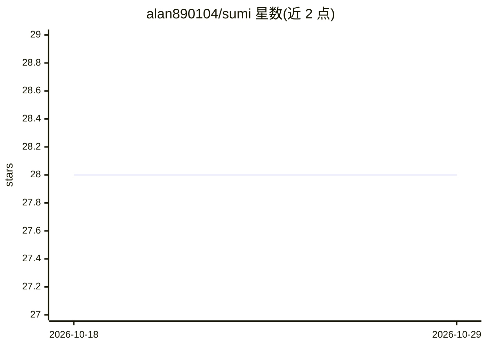

# alan890104/sumi

⭐ 28 · Rust · NOASSERTION · 推送 2026-09-25 · [GitHub](https://github.com/alan890104/sumi) · [官网](https://sumivoice.com) · 个人维护 · 中文 README

**macOS 全局语音听写工具：本地 Whisper 转写 + LLM 润色**

常驻菜单栏的 macOS 语音转文字应用：按热键在任意应用中录音，本地 Whisper（Metal GPU，7 档模型）或 Qwen3-ASR 转写，再由本地 LLM（Qwen3-8B/Qwen2.5-7B/Llama 3 Taiwan 8B，经 candle）或云端 API 按当前应用润色后粘贴到光标处。含 18 条按应用定制的润色规则、语音改写选中文字、带说话人标注的会议转写模式、Silero VAD 与发音词典。云端支持 BYOK（Groq/OpenAI/Gemini/OpenRouter 等），无账号订阅。GPLv3，Homebrew/DMG 安装，Windows 需从源码构建。

## 筛选速览

| 维度 | 判定 | 备注 |
|---|---|---|
| AI 角色 | `ai-native` | 本体是模型或模型工具 |
| 许可风险 | `none` | NOASSERTION |
| 部署形态 | `desktop` | 安装包/桌面程序 |
| 模型依赖 | locked-api |  |
| 硬件要求 | — | 无带数字的原话,不猜 |
| 安装摩擦 | `high` | 编译与系统依赖俱全 |
| 成熟度 | — | 结构信号不足 |

## 能力要点

- 本地 Whisper（Metal）/Qwen3-ASR 转写 + candle 本地 LLM 润色，音频可不离开设备
- 按当前应用使用不同 LLM 提示词润色（18 条内置规则，可自然语言生成新规则）
- 会议模式后台连续转写并按说话人加时间戳标注，支持导入已有音频
- 58 种界面语言，繁体中文用户自动做 zh-CN→zh-TW 规范化

## 适用场景

- 在邮件、聊天、笔记等不同应用里用语音输入并自动匹配文体
- 会议中后台连续转写并区分说话人生成笔记
- 选中文字后用语音下指令让 AI 改写、翻译或精简

## 场景标签

`语音识别` `AI 写作` · 领域:内容生成

## 证据(README 行号)

> L11: **System-wide speech-to-text for macOS. Free and open source.**
> L33: Run everything on-device: Whisper or Qwen3-ASR for speech recognition, local LLM for rewriting. Audio never leaves 
> L73: **Speech recognition** — Local: Whisper (Metal GPU, 7 model sizes from 148 MB to 1.6 GB) or Qwen3-ASR. Cloud: Groq,

## 星数曲线

2026-10-18 28 → 2026-10-29 28（+0）

---
*卡片 v1 · prompt 1.4 · 生成 2026-10-26 · 置信度 high · 依据 README sha `e44e67db8d7c` · [字段定义](../../DATASET.md)*
