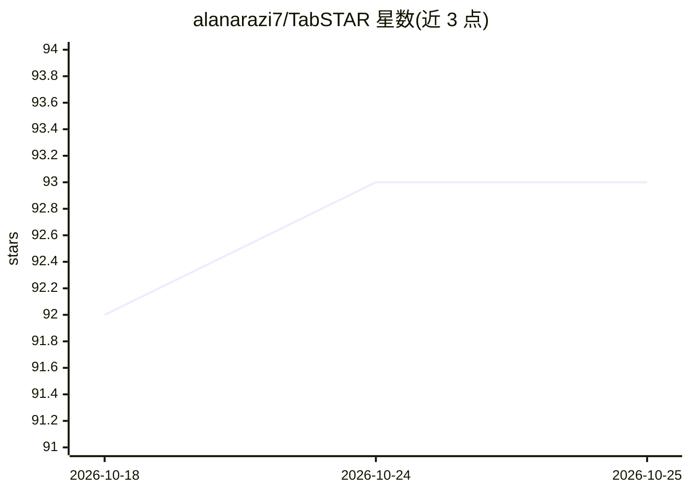

# alanarazi7/TabSTAR

⭐ 93 · Python · MIT · 推送 2026-10-16 · [GitHub](https://github.com/alanarazi7/TabSTAR) · 组织维护

**表格+文本字段数据的基础模型，提供分类/回归预测**

面向含文本字段表格数据的基础模型，NeurIPS 2025 论文配套开源。提供包模式：pip 安装 tabstar 后以 sklearn 风格的 fit/predict 接口做分类与回归，含 v1.1 新一代预训练模型（独立模块，旧代码不受影响）。另提供研究模式：克隆仓库后经 init.sh 配置环境，可运行论文基准评测（400 个数据集）、预训练与微调流水线。限制：微调下游任务仅支持论文中的 400 个数据集。

## 筛选速览

| 维度 | 判定 | 备注 |
|---|---|---|
| AI 角色 | `ai-native` | 本体是模型或模型工具 |
| 许可风险 | `permissive` | MIT |
| 部署形态 | `library` | 以包/库形式分发 |
| 模型依赖 | — | README 未给出锁定关系 |
| 硬件要求 | — | 无带数字的原话,不猜 |
| 安装摩擦 | `low` | 无编译、无系统依赖或容器化 |
| 成熟度 | — | 结构信号不足 |

## 能力要点

- sklearn 风格 API（fit/predict/predict_proba/save/load）的分类与回归估计器
- TabSTAR v1.1 新一代预训练模型，drop-in 替换旧模型
- 预训练/微调/基准评测研究流水线，覆盖论文 400 个数据集

## 适用场景

- 在自己的含文本列表格数据上直接做分类或回归预测
- 复现论文基准结果或与其他基线方法对比
- 自定义预训练与微调 TabSTAR 模型

## 场景标签

`微调` `模型训练` `模型评测` · 领域:评测与运维

## 证据(README 行号)

> L13: You can either use TabSTAR as a package for your own tabular data tasks, or explore the full repository for researc
> L35: Use this mode if you want to fit a pretrained TabSTAR model to your own dataset.

## 星数曲线

2026-10-18 92 → 2026-10-25 93（+1）

---
*卡片 v1 · prompt 1.4 · 生成 2026-10-23 · 置信度 high · 依据 README sha `cc727cea0201` · [字段定义](../../DATASET.md)*
