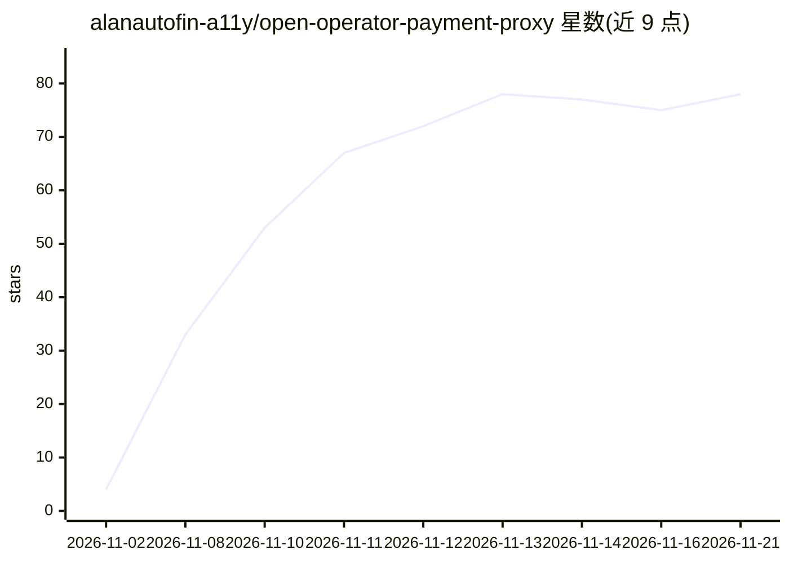

# alanautofin-a11y/open-operator-payment-proxy

⭐ 78 · 推送 2026-11-02 · [GitHub](https://github.com/alanautofin-a11y/open-operator-payment-proxy) · [官网](https://app.coregold.io/signup?invite_code=ADvlj9b) · 组织维护 · 中文 README

**面向 AI Agent 支付场景的 CoreGold 虚拟卡介绍文档**

仓库以中文文章形式讨论 AI Agent（Computer Use/Operator 类）接管浏览器操作时在支付结算环节遇到的问题：无头浏览器指纹触发反爬熔断、Agent 重试死循环刷爆主卡、明文缓存的卡信息暴露。随后引出 CoreGold 欧美商业级虚拟卡作为应对方案，给出 INI 格式的 Agent 沙箱配置示例（BIN、发卡行信任等级等字段）。README 可见部分为介绍性文案，未见可安装运行的软件代码、安装命令或使用说明。

## 筛选速览

| 维度 | 判定 | 备注 |
|---|---|---|
| AI 角色 | `ai-ecosystem` | LLM/agent 周边工具 |
| 许可风险 | `none` | — |
| 部署形态 | `None` |  |
| 模型依赖 | — | README 未给出锁定关系 |
| 硬件要求 | — | 无带数字的原话,不猜 |
| 安装摩擦 | `low` | 无编译、无系统依赖或容器化 |
| 成熟度 | — | 结构信号不足 |

## 能力要点

- 罗列 Agent 自动支付的三类风险场景（反爬熔断、重试刷爆主卡、明文暴露）
- 以 INI 配置示例展示 CoreGold 虚拟卡的 Agent 沙箱字段
- 提及 US Visa Commercial / US MC Business 的 BIN 号

## 适用场景

- 了解 AI Agent 自动化支付环节的风险叙述
- 查看 CoreGold 虚拟卡面向 Agent 场景的配置字段写法

## 场景标签

 · 领域:支付/Agent 基础设施

## 证据(README 行号)

> L8: 开发者不再手动点击结算，而是让 Agent 自动巡检、批量采买 SaaS 凭证、自主注册海外服务或调度算力。但真正的工程灾难往往爆发在支付结算环节：
> L19: 利用 **CoreGold** 欧美商业级虚拟卡，将支付凭证作为一次性基础设施资源纳入流水线管理：

## 星数曲线

2026-11-02 4 → 2026-11-21 78（+74）

---
*卡片 v1 · prompt 1.4 · 生成 2026-11-18 · 置信度 low · 依据 README sha `79c8a0f0a83d` · [字段定义](../../DATASET.md)*
