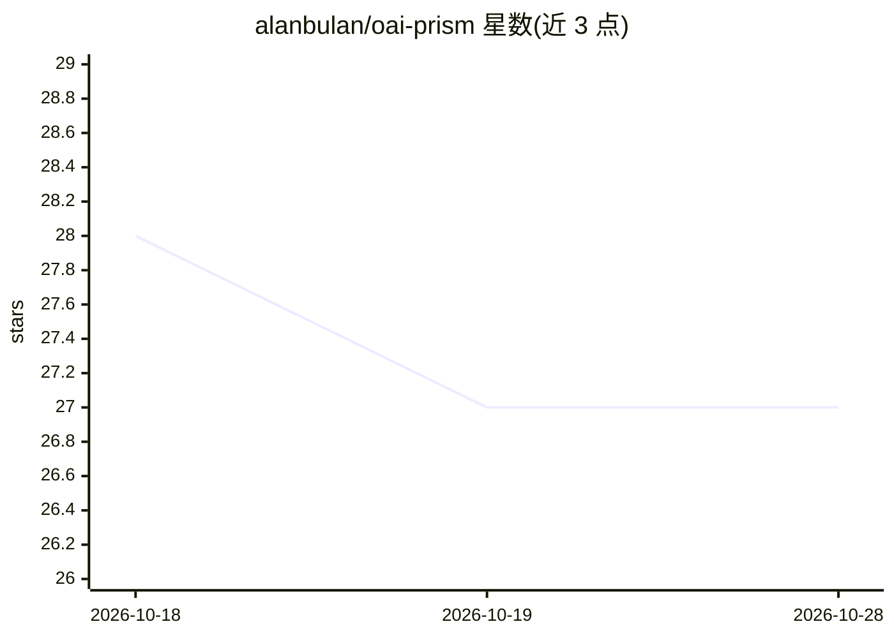

# alanbulan/oai-prism

⭐ 27 · Go · MIT · 推送 2026-10-06 · [GitHub](https://github.com/alanbulan/oai-prism) · 个人维护 · 中文 README

**把 OpenAI Prism 私有协议转成标准 API 的 Go 网关**

Go 单二进制网关，将 prism.openai.com 的私有协议（start+轮询、Sentinel 反自动化令牌、浏览器指纹）翻译为 OpenAI Chat Completions/Responses 与 Anthropic Messages 兼容接口，客户端改 base_url 即可接入，Codex CLI 与 Claude Code 可作为本地工具桥执行端。提供多账号池调度（并发闸门、会话粘性、失败冷却、凭据自动续期、SQLite 持久化）与内置管理控制台（账号管理、API Key 签发、请求审计、对话调试台）。需 Go 1.26+ 构建，CGO free，MIT 许可。README 声明与 OpenAI 无隶属关系，提醒用户自行确认符合上游服务条款。

## 筛选速览

| 维度 | 判定 | 备注 |
|---|---|---|
| AI 角色 | `ai-ecosystem` | LLM/agent 周边工具 |
| 许可风险 | `permissive` | MIT |
| 部署形态 | `library` | 以包/库形式分发 |
| 模型依赖 | — | README 未给出锁定关系 |
| 硬件要求 | — | 无带数字的原话,不猜 |
| 安装摩擦 | `low` | 无编译、无系统依赖或容器化 |
| 成熟度 | — | 结构信号不足 |

## 能力要点

- OpenAI Chat/Responses 与 Anthropic Messages 兼容接口，含完整流式事件序列
- 多账号池调度：并发闸门、会话粘性、凭据自动续期、SQLite 持久化、热重载
- Codex CLI / Claude Code 本地工具桥，上游推理、本机执行
- 内置控制台：账号管理、API Key 签发、吞吐统计、请求审计、Chat 调试台

## 适用场景

- 让现有 OpenAI/Anthropic SDK 与工具链通过标准 API 使用 Prism
- Codex CLI 在本地执行命令与读写文件、由 Prism 负责推理
- 多账号池化管理上游凭据与并发调度

## 场景标签

`模型网关` · 领域:Agent 开发

## 证据(README 行号)

> L7:  Go 单二进制网关：OpenAI Chat / Responses、Anthropic Messages、Codex CLI 开箱即用。
> L35: OAIprism 把这些全部收进网关，对外只暴露你已经在用的标准接口 ——

## 星数曲线

2026-10-18 28 → 2026-10-28 27（-1）

---
*卡片 v1 · prompt 1.4 · 生成 2026-10-26 · 置信度 mid · 依据 README sha `11dac94f6da2` · [字段定义](../../DATASET.md)*
