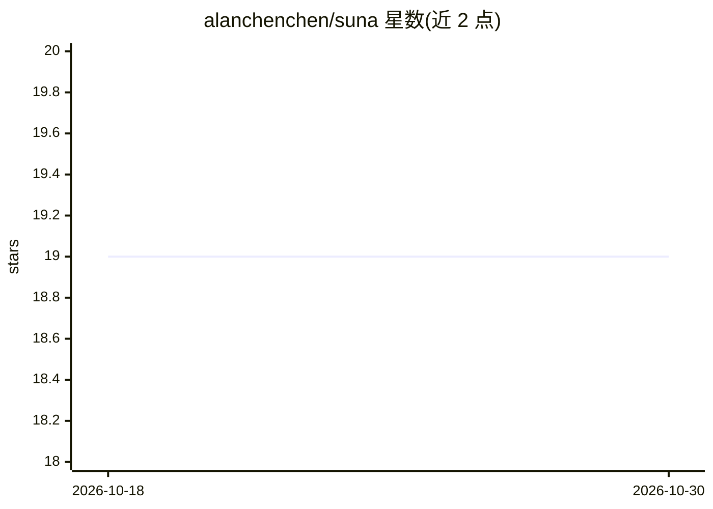

# alanchenchen/suna

⭐ 19 · Go · MIT · 推送 2026-10-20 · [GitHub](https://github.com/alanchenchen/suna) · 个人维护 · 中文 README

**本地优先的终端 AI Agent 运行时，支持任务委派与安全审查**

Go 编写的本地 Agent Runtime，在用户机器上运行会话、工具、Guard 与持久化。可连接 OpenAI、Anthropic 或 OpenAI 兼容模型服务；主 Agent 可通过 spawn 将子任务委派给不同模型，子任务显式指定工具白名单与上下文，不自动继承主对话历史。提供内置 TUI 与官方 Web 客户端（Suna App），预编译二进制覆盖 macOS/Linux/Windows。Guard 提供应用级安全检查（smart/ask/auto/readonly 四种模式），非 OS 沙箱；MCP 服务器目前绕过 Guard。

## 筛选速览

| 维度 | 判定 | 备注 |
|---|---|---|
| AI 角色 | `ai-native` | 本体是模型或模型工具 |
| 许可风险 | `permissive` | MIT |
| 部署形态 | `desktop` | 安装包/桌面程序 |
| 模型依赖 | — | README 未给出锁定关系 |
| 硬件要求 | — | 无带数字的原话,不猜 |
| 安装摩擦 | `low` | 无编译、无系统依赖或容器化 |
| 成熟度 | `idea` | |

## 能力要点

- 任务级模型委派：spawn 显式指定模型、自包含任务与工具白名单
- Guard 应用级安全检查，smart 模式下非只读 exec 由 LLM 审查
- 单个 Go 二进制，预编译支持 macOS/Linux/Windows，无需 Node.js
- 内置 TUI 与官方 Web 客户端共用同一 Runtime，提供公开本地协议

## 适用场景

- 在终端用自然语言处理本地文件、代码与自动化任务
- 将探索、实现、评审拆给不同模型做交叉委派
- 以工具白名单与确认模式执行带审查的文件改动

## 场景标签

`Agent 框架` · 领域:Agent 开发

## 证据(README 行号)

> L5: > A local-first, general-purpose AI agent: choose your models, delegate bounded work, and use the terminal or offici
> L7: Suna runs the Agent, tools, and session management on your machine. Connect OpenAI, Anthropic, or OpenAI-compatible 
> L37: The built-in TUI and official Suna App connect to the same Runtime, which owns sessions, Agent runs, tools, Guard, 

## 星数曲线

2026-10-18 19 → 2026-10-30 19（+0）

---
*卡片 v1 · prompt 1.4 · 生成 2026-10-28 · 置信度 high · 依据 README sha `2771b782dd28` · [字段定义](../../DATASET.md)*
