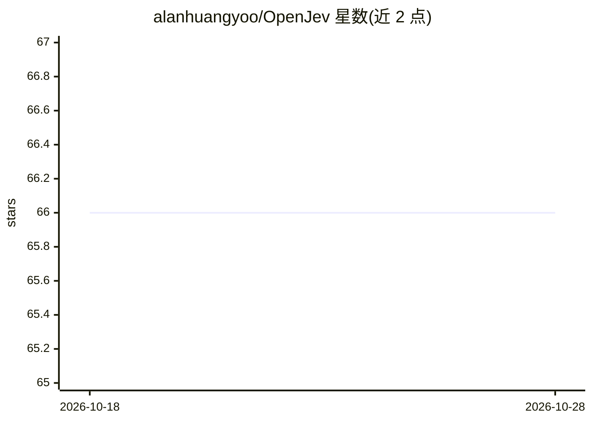

# alanhuangyoo/OpenJev

⭐ 66 · Python · Apache-2.0 · 推送 2026-10-09 · [GitHub](https://github.com/alanhuangyoo/OpenJev) · 组织维护 · 中文 README

**开源本地决策模型：为浏览器 agent 输出校准概率**

提供 OpenJev-1.7B/4B/8B 三个 System-One 决策模型（Apache-2.0 权重），接收类型化问题（choice/yes-no/score），一次前向输出校准概率，不生成文本、无需 API key，可在自有 GPU 或笔记本上本地运行。面向 browser agent 的步骤决策（选操作、选元素、何时 DONE）与通用决策（分诊、路由、策略检查）。基于 Qwen3 底座去掉词表头并以 LoRA 训练合并，通过界面蒸馏从 qwen3-max 教师与 Mind2Web/NNetNav 数据构造训练集。限制：仅英文、部分训练数据有商用条款限制、在 Kev 自有套件上 Kev 更准。

## 筛选速览

| 维度 | 判定 | 备注 |
|---|---|---|
| AI 角色 | `ai-native` | 本体是模型或模型工具 |
| 许可风险 | `permissive` | Apache-2.0 |
| 部署形态 | `library` | 以包/库形式分发 |
| 模型依赖 | — | README 未给出锁定关系 |
| 硬件要求 | — | 无带数字的原话,不猜 |
| 安装摩擦 | `medium` | 含编译或系统依赖之一 |
| 成熟度 | — | 结构信号不足 |

## 能力要点

- 类型化问题输入，一次前向输出校准概率（ECE 0.01–0.04），不生成文本
- 提供 1.7B/4B/8B 三个模型，4B 版 8.4 GB 可在单张消费级 GPU 运行
- 兼容 POST /v1/systemone 请求形态，可替换 hosted System One 端点（如 jev-ultrafast）
- 附带 OpenJev-Bench 冻结浏览器评测集与 wev serve HTTP 服务、训练/蒸馏脚本

## 适用场景

- 在本地 GPU 上为浏览器 agent 提供‘选操作/选元素/是否 DONE’的决策步骤
- agent 系统中做分诊、路由、策略检查等通用类型化决策
- 用已发表的蒸馏流程与数据集训练自己的 System One 决策模型

## 场景标签

`浏览器自动化` `微调` · 领域:效率与自动化

## 证据(README 行号)

> L4: Typed questions in, calibrated probabilities out, in one forward pass. No text generation, no API key.
> L23: agent monitoring, and it handles browser-agent steps: *which operation?* and *which element?* It runs on your own
> L187: **Model.** A Qwen3 base model with its vocabulary head removed, adapted with LoRA and merged into the released

## 星数曲线

2026-10-18 66 → 2026-10-28 66（+0）

---
*卡片 v1 · prompt 1.4 · 生成 2026-10-24 · 置信度 high · 依据 README sha `30708fcdafc7` · [字段定义](../../DATASET.md)*
