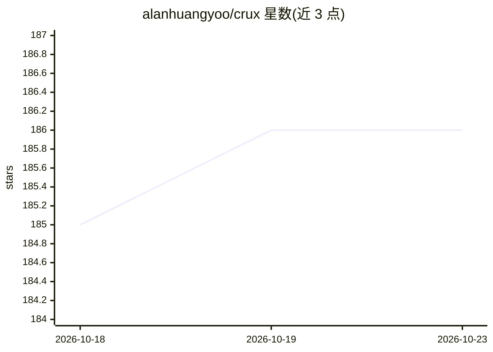

# alanhuangyoo/crux

⭐ 186 · TypeScript · MIT · 推送 2026-10-07 · [GitHub](https://github.com/alanhuangyoo/crux) · 个人维护 · 中文 README

**基于 pi 重构的终端编程 agent，Terminal-Bench 2.1 达 0.773 pass@1**

在 pi 编码 agent 之上重构 agent 层的长时程终端任务编程 agent，模型本身不变（自托管 Qwen3.8-27B）。改动覆盖：上下文引擎（压缩请求按窗口大小调整、失败缩小重试、任务原文逐次携带，压缩成功率 14%→100%）、显式状态机的 agent 循环（截断输出两阶段恢复、停滞检测、按任务截止时间配速，截断输出 18.0%→0.7%）、运行时（流空闲看门狗、进程树回收、OOM 后恢复）、工具层改进。附带基于 harbor 的评测 harness，含逐任务配对符号检验。

## 筛选速览

| 维度 | 判定 | 备注 |
|---|---|---|
| AI 角色 | `ai-native` | 本体是模型或模型工具 |
| 许可风险 | `permissive` | MIT |
| 部署形态 | `None` |  |
| 模型依赖 | — | README 未给出锁定关系 |
| 硬件要求 | — | 无带数字的原话,不猜 |
| 安装摩擦 | `low` | 无编译、无系统依赖或容器化 |
| 成熟度 | — | 结构信号不足 |

## 能力要点

- 上下文压缩成功率 14%→100%，任务原文在每次压缩中逐字保留
- 截断输出率 18.0%→0.7%，两阶段恢复与停滞检测
- 流空闲看门狗、进程树回收与 OOM 后恢复支撑多小时运行
- benchmark/ 提供基于 harbor 的评测 harness 与配对符号检验

## 适用场景

- 执行长时程终端环境中的编程任务
- 复现或对比 Terminal-Bench 2.1 上的 agent 表现
- 在自托管 27B 模型上运行编程 agent

## 场景标签

`编码 Agent` `模型评测` · 领域:编码与开发

## 证据(README 行号)

> L3:  A coding agent built on pi, re-engineered for long-horizon terminal tasks. Terminal-Bench 2.1 pass@1 from 0.539 to 
> L22: Self-hosted Qwen3.8-27B, identical weights for every agent · 89 tasks · pass@1

## 星数曲线

2026-10-18 185 → 2026-10-23 186（+1）

---
*卡片 v1 · prompt 1.4 · 生成 2026-10-22 · 置信度 high · 依据 README sha `d52c3f2965f3` · [字段定义](../../DATASET.md)*
