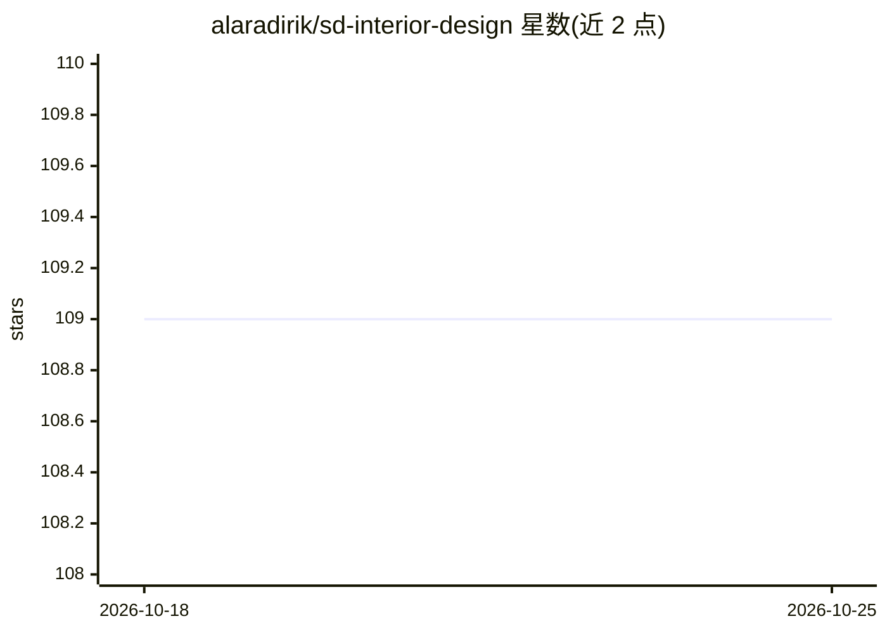

# alaradirik/sd-interior-design

⭐ 109 · Python · MIT · 推送 2026-06-08 · [GitHub](https://github.com/alaradirik/sd-interior-design) · 个人维护

**保持布局的室内设计图像生成 API（Realistic Vision + ControlNet）**

基于 Realistic Vision V3.0 inpainting 管线、结合分割与 MLSD ControlNet 的室内设计图像生成项目，通过文本与图像提示在保留房间布局的前提下生成室内设计图。使用 Cog 打包为 Docker 化 API，提供 cog predict 单次预测与 cog run 启动 HTTP 服务两种用法；API 参数包括 image、prompt、negative_prompt、推理步数、guidance_scale、prompt_strength 与 seed。灵感来自 AICrowd 生成式室内设计黑客松，代码以 MIT 许可发布，基础模型与 ControlNet 有各自许可需另行查看。

## 筛选速览

| 维度 | 判定 | 备注 |
|---|---|---|
| AI 角色 | `ai-native` | 本体是模型或模型工具 |
| 许可风险 | `permissive` | MIT |
| 部署形态 | `None` |  |
| 模型依赖 | — | README 未给出锁定关系 |
| 硬件要求 | — | 无带数字的原话,不猜 |
| 安装摩擦 | `low` | 无编译、无系统依赖或容器化 |
| 成熟度 | — | 结构信号不足 |

## 能力要点

- Realistic Vision V3.0 inpainting 管线 + 分割 + MLSD ControlNet
- 通过 Cog 打包为 Docker 化 API（cog predict / HTTP 服务）
- 支持正/负提示词、推理步数、guidance_scale、prompt_strength、seed 等参数控制

## 适用场景

- 上传房间照片并按文字描述生成保留布局的室内设计方案
- 以 API 形式部署室内设计图像生成服务
- 通过 Replicate 演示在线试用效果

## 场景标签

`图像生成` · 领域:内容生成

## 证据(README 行号)

> L2: A custom interior design pipeline API that combines Realistic Vision V3.0 inpainting pipeline with segmentation and 
> L8: cog predict -i image=@test_images/bedroom_3.jpg prompt="A bedroom with a bohemian spirit centered around a relaxed c

## 星数曲线

2026-10-18 109 → 2026-10-25 109（+0）

---
*卡片 v1 · prompt 1.4 · 生成 2026-10-23 · 置信度 high · 依据 README sha `2abd31f0cdc9` · [字段定义](../../DATASET.md)*
