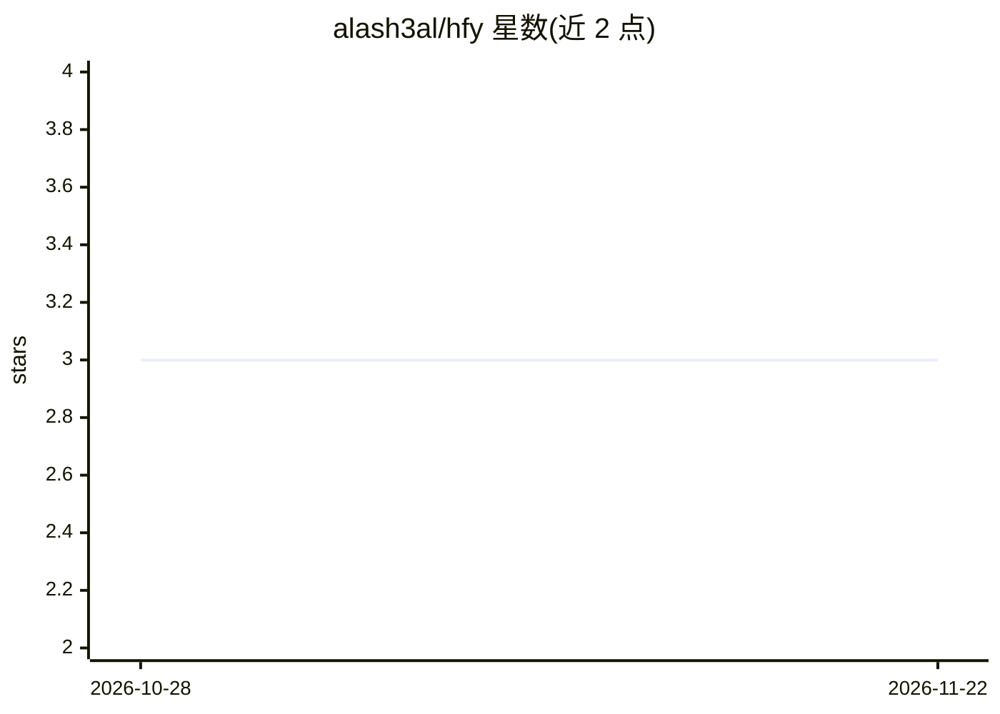

# alash3al/hfy

⭐ 3 · Go · MIT · 推送 2026-11-01 · [GitHub](https://github.com/alash3al/hfy) · [官网](https://alash3al.github.io/hfy/) · 个人维护

**自托管 AI 对话后端与聊天窗口，嵌入现有应用**

用 Go 编写的自托管后端，为应用提供 AI 对话能力：运行模型、调用工具、持久化每条会话，并通过 iframe/WebView/HTTP API 提供可嵌入的聊天窗口。支持 OpenAI、OpenRouter、Ollama 等任何兼容 OpenAI API 的模型；工具经 MCP 接入并携带请求者身份；支持多人多助手房间、风险操作审批、向用户表单提问。运行仅依赖单一二进制与 Postgres，配置经 YAML 管理。

## 筛选速览

| 维度 | 判定 | 备注 |
|---|---|---|
| AI 角色 | `ai-ecosystem` | LLM/agent 周边工具 |
| 许可风险 | `permissive` | MIT |
| 部署形态 | `self-host` | docker 或自建部署 |
| 模型依赖 | local-ok | 支持本地模型 |
| 硬件要求 | — | 无带数字的原话,不猜 |
| 安装摩擦 | `low` | 无编译、无系统依赖或容器化 |
| 成熟度 | — | 结构信号不足 |

## 能力要点

- 单二进制 + Postgres 的最小部署栈
- 经 MCP 接入自有工具，每次调用携带请求者身份 (_meta)
- 风险操作审批机制与会话消息不丢失的持久化
- 内置 mock 模型，无需网络即可试运行

## 适用场景

- 在自己的网站或移动/桌面应用里嵌入 AI 聊天窗口
- 让 AI 助手调用业务工具并按身份控制权限
- 自托管方式管理应用内 AI 对话数据

## 场景标签

`聊天机器人` · 领域:对话与助手

## 证据(README 行号)

> L5: hfy is a backend and chat window for AI conversations that you run yourself.
> L17: - **Any model**: OpenAI, OpenRouter, Ollama or anything that speaks the OpenAI API.
> L23: - **One binary and Postgres.** That's the whole stack.

## 星数曲线

2026-10-28 3 → 2026-11-22 3（+0）

---
*卡片 v1 · prompt 1.4 · 生成 2026-11-22 · 置信度 mid · 依据 README sha `05aa9bd9ce3c` · [字段定义](../../DATASET.md)*
