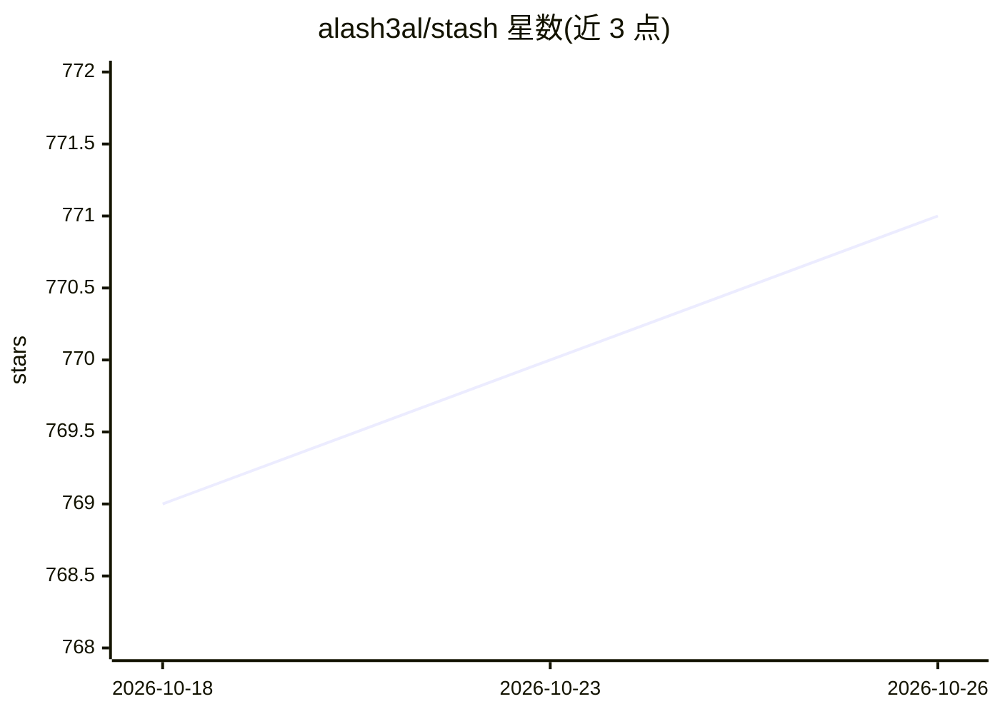

# alash3al/stash

⭐ 771 · Go · Apache-2.0 · 推送 2026-06-14 · [GitHub](https://github.com/alash3al/stash) · [官网](https://usestash.io/) · 个人维护

**面向 AI agent 的持久记忆层：Postgres 存储会话、事实与上下文**

自托管的开源 MCP 服务器，为 AI agent 提供跨会话的持久记忆：以 Postgres + pgvector 存储情节（episodes）、事实与工作上下文，通过 9 阶段后台整理管道把原始观察转化为事实、关系、因果与模式等结构化知识，每阶段仅处理增量数据。Docker Compose 单命令启动，兼容任何支持 MCP over SSE 的客户端（Claude Desktop、Cursor、Windsurf 等），也可配合 Ollama 完全本地运行；另有独立托管的云端版 usestash.io（Beta 免费，与本仓库无共享代码）。

## 筛选速览

| 维度 | 判定 | 备注 |
|---|---|---|
| AI 角色 | `ai-ecosystem` | LLM/agent 周边工具 |
| 许可风险 | `permissive` | Apache-2.0 |
| 部署形态 | `self-host` | docker 或自建部署 |
| 模型依赖 | local-ok | 支持本地模型 |
| 硬件要求 | — | 无带数字的原话,不猜 |
| 安装摩擦 | `low` | 无编译、无系统依赖或容器化 |
| 成熟度 | — | 结构信号不足 |

## 能力要点

- Postgres + pgvector 存储 episodes、facts 与 working context
- 9 阶段整理管道：观察→事实→关系→因果→模式，含矛盾检测与目标跟踪
- 内置 MCP server（SSE），兼容 Claude Desktop / Cursor / Windsurf 等客户端
- 支持 Ollama 全本地部署（私有 embedding 与 reasoner），无需云 API

## 适用场景

- 让 Claude Desktop / Cursor 等 agent 客户端获得跨会话记忆
- 自托管私有记忆层，配合 Ollama 实现无云端 API 的本地方案
- 通过 init / remember / recall MCP 工具管理 agent 上下文

## 场景标签

`Agent 记忆` · 领域:Agent 开发

## 证据(README 行号)

> L3: **Your AI has amnesia. We fixed it.**
> L21: That's it. Postgres + pgvector, migrations, MCP server with background consolidation — all in one command.
> L53: After `docker compose up`, Stash exposes an MCP server over SSE at:
> L93: Works with any agent that supports MCP over SSE — Claude Desktop, Cursor, Windsurf, Cline, Continue, OpenAI Agents,

## 星数曲线

2026-10-18 769 → 2026-10-26 771（+2）

---
*卡片 v1 · prompt 1.4 · 生成 2026-10-21 · 置信度 high · 依据 README sha `5cee4c5de0f2` · [字段定义](../../DATASET.md)*
