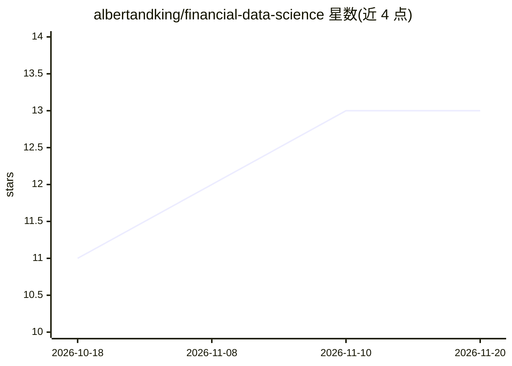

# albertandking/financial-data-science

⭐ 13 · Jupyter Notebook · NOASSERTION · 推送 2026-06-15 · [GitHub](https://github.com/albertandking/financial-data-science) · [官网](https://albertandking.github.io/financial-data-science/) · 个人维护 · 中文 README

**面向中国本科与研究生生的金融数据科学开源教材**

一本以 Markdown 正文加 Jupyter Notebook 代码组织的金融数据科学教材，覆盖数据获取、机器学习、回测等主题。数据来源为内置示例数据集（离线可跑）与 akshare/tushare 中国市场接口（联网抓取）；环境由 uv 管理并用 uv.lock 锁定版本以保证复现。每章提供 Colab 与 Binder 徽章可在云端直接运行；正文与成书由 MkDocs Material 构建，通过 GitHub Actions 自动部署到 GitHub Pages。代码采用 MIT、正文采用 CC BY 4.0 双许可。

## 筛选速览

| 维度 | 判定 | 备注 |
|---|---|---|
| AI 角色 | `ai-knowledge` | 知识聚合/清单类 |
| 许可风险 | `none` | NOASSERTION |
| 部署形态 | `None` |  |
| 模型依赖 | — | README 未给出锁定关系 |
| 硬件要求 | — | 无带数字的原话,不猜 |
| 安装摩擦 | `low` | 无编译、无系统依赖或容器化 |
| 成熟度 | — | 结构信号不足 |

## 能力要点

- 每章 notebook 带 Colab 与 Binder 徽章，云端无需本地环境即可运行
- 内置示例数据集支持断网逐格运行，联网接口代码单独标注
- uv.lock 锁定全部依赖精确版本，保证复现
- 正文按需引用/嵌入 notebook 导出的代码与输出，避免两处维护

## 适用场景

- 作为本科生或研究生的金融数据科学课程教材
- 在 Colab/Binder 上零环境运行各章代码学习
- 本地用 uv 复现教材中的分析与回测实验
- 基于该仓库结构撰写或改进自己的教学材料

## 场景标签

`教程课程` `金融量化` · 领域:学习与行业

## 证据(README 行号)

> L3: 面向**中国本科生与研究生**的金融数据科学教材。
> L6: - **代码**放在 Jupyter Notebook 中（`notebooks/` 目录），可本地逐格运行
> L15: - ▶️ **在线运行代码**：每章正文顶部都有 **Colab** 与 **Binder** 徽章，点开即可在云端运行该章 notebook（无需本地环境）。

## 星数曲线

2026-10-18 11 → 2026-11-20 13（+2）

---
*卡片 v1 · prompt 1.4 · 生成 2026-11-18 · 置信度 high · 依据 README sha `a6d8a860590b` · [字段定义](../../DATASET.md)*
