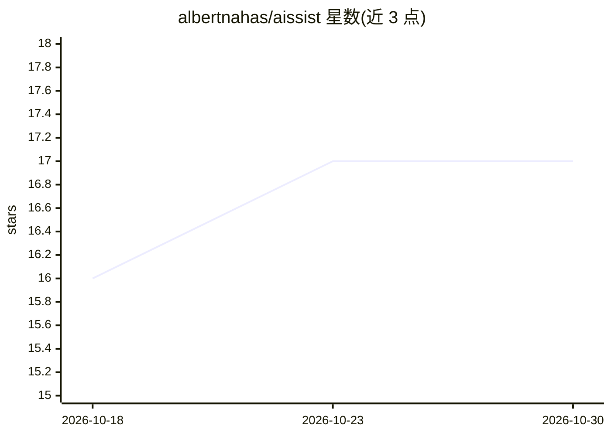

# albertnahas/aissist

⭐ 17 · TypeScript · MIT · 推送 2026-01-09 · [GitHub](https://github.com/albertnahas/aissist) · [官网](https://www.aissistcli.dev) · 个人维护

**本地优先的 AI 命令行个人助理，管理目标、待办与历史**

Aissist 是一个 npm 安装的 CLI 个人助理，以本地 Markdown 文件存储目标（goal）、待办（todo）、历史记录、上下文笔记与反思。AI 功能依赖 Claude Code CLI：生成行动建议、基于文件分析的语义搜索、智能日志润色与目标代号生成；Claude Code 不可用时回退到关键词搜索或原始文本。支持全局（~/.aissist/）与项目级（./.aissist/）双存储、父子目录间进度同步（progress.json），数据以 YAML front matter 的 Markdown 格式存储，兼容 Git 版本控制。

## 筛选速览

| 维度 | 判定 | 备注 |
|---|---|---|
| AI 角色 | `ai-enhanced` | 去掉 AI 部分产品仍成立 |
| 许可风险 | `permissive` | MIT |
| 部署形态 | `library` | 以包/库形式分发 |
| 模型依赖 | locked-api |  |
| 硬件要求 | — | 无带数字的原话,不猜 |
| 安装摩擦 | `low` | 无编译、无系统依赖或容器化 |
| 成熟度 | — | 结构信号不足 |

## 能力要点

- 所有数据存储为本地 Markdown 文件，支持全局与项目级双模式
- 通过 Claude Code 生成行动建议与语义搜索（recall），不可用时回退关键词搜索
- goal/todo/history/context/reflect/sync 等命令覆盖目标管理与时间线追踪
- sync 命令支持父子 .aissist 目录间的层级进度聚合

## 适用场景

- 在终端里追踪个人目标、待办与日常活动记录
- 让 AI 基于我的历史和目标生成下一步行动建议
- 跨多个项目目录同步和聚合目标进度
- 对个人记忆库做自然语言的语义检索

## 场景标签

`AI 助手` `知识库管理` · 领域:对话与助手

## 证据(README 行号)

> L6: Aissist is a local-first, AI-powered CLI personal assistant that helps you track what you've done, manage what you'r
> L12: - **Claude Code Integration**: Seamlessly works with Claude Code for AI-powered recall, proposals, and semantic sea
> L14: - **Local-First & Markdown**: All data stored in human-readable Markdown files on your machine

## 星数曲线

2026-10-18 16 → 2026-10-30 17（+1）

---
*卡片 v1 · prompt 1.4 · 生成 2026-10-29 · 置信度 high · 依据 README sha `828ecc8543dd` · [字段定义](../../DATASET.md)*
