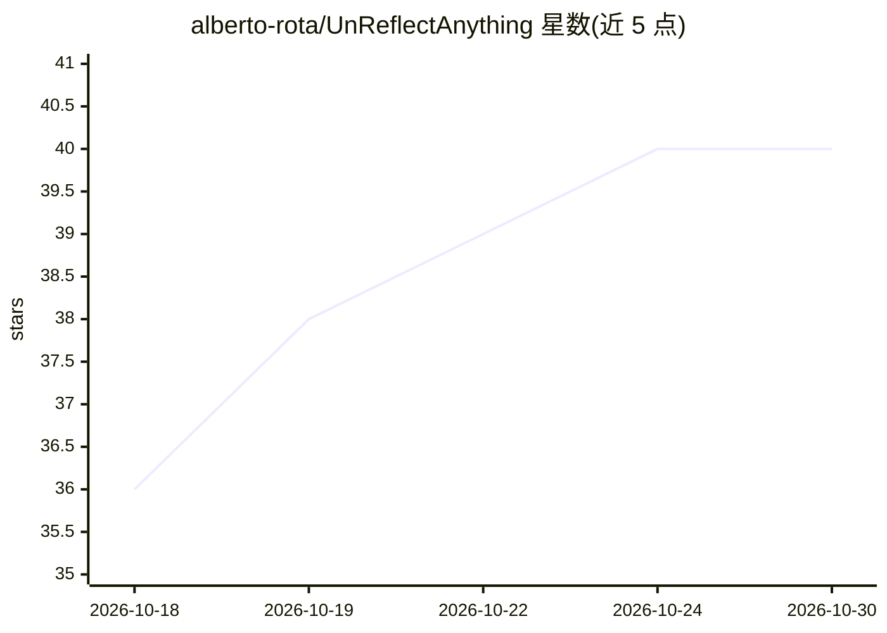

# alberto-rota/UnReflectAnything

⭐ 40 · Python · MIT · 推送 2026-08-07 · [GitHub](https://github.com/alberto-rota/UnReflectAnything) · [官网](https://alberto-rota.github.io/UnReflectAnything/) · 组织维护

**RGB 图像镜面高光去除模型，输出纯漫反射图像**

输入任意 RGB 图像即可去除镜面高光、返回仅含漫反射分量的图像的深度学习模型（CVPR 2026 Oral 论文）。训练方式为合成镜面反光样本并在 DINOv3 特征空间中监督，适用于自然室内场景与手术/内窥镜领域数据。以 pip 包形式提供，附 CLI（unreflectanything/unreflect/ura 别名）与 Python API，支持推理、权重下载、缓存管理与训练/测试/评测；权重与示例图像存于 HuggingFace 仓库。官方权重尚未正式发布，v1.0.2 默认 pretrained=False，强行设 True 会警告且不下载。

## 筛选速览

| 维度 | 判定 | 备注 |
|---|---|---|
| AI 角色 | `ai-native` | 本体是模型或模型工具 |
| 许可风险 | `permissive` | MIT |
| 部署形态 | `library` | 以包/库形式分发 |
| 模型依赖 | — | README 未给出锁定关系 |
| 硬件要求 | — | 无带数字的原话,不猜 |
| 安装摩擦 | `medium` | 含编译或系统依赖之一 |
| 成熟度 | `idea` | |

## 能力要点

- RGB 单输入的镜面高光去除，输出 diffuse-only 图像
- 合成镜面样本 + DINOv3 特征空间监督的训练方式
- 同时支持自然室内与手术/内窥镜领域数据
- 提供 CLI 与 Python API，覆盖推理/下载/验证/引用等子命令

## 适用场景

- 我需要批量去除室内场景照片的镜面高光
- 我处理内窥镜/手术图像时想去除反光干扰
- 我在论文中复现该 CVPR 方法并引用 BibTeX

## 场景标签

`图像视频处理` · 领域:感知与多模态

## 证据(README 行号)

> L13: UnReflectAnything inputs any RGB image and removes specular highlights, returning a clean diffuse-only output. We t
> L15: UnReflectAnything works on both natural indoor and surgical/endoscopic domain data.

## 星数曲线

2026-10-18 36 → 2026-10-30 40（+4）

---
*卡片 v1 · prompt 1.4 · 生成 2026-10-25 · 置信度 high · 依据 README sha `750b9b8b6420` · [字段定义](../../DATASET.md)*
