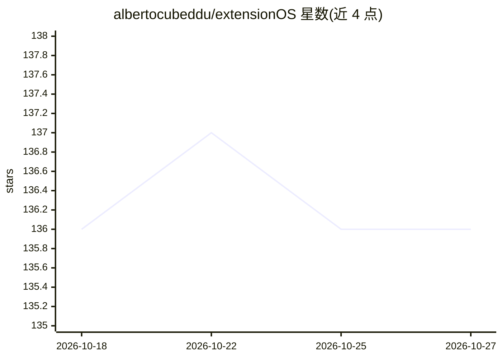

# albertocubeddu/extensionOS

⭐ 136 · TypeScript · NOASSERTION · 推送 2026-06-24 · [GitHub](https://github.com/albertocubeddu/extensionOS) · 个人维护

**浏览器扩展：右键对选中文本调用各 LLM 执行自定义提示词**

基于 Plasmo 框架的 Chrome 扩展（兼容 Edge/Opera/Brave），用户选中网页文本后右键即执行自定义提示词（如语法修正），无需切换标签页。支持多 LLM 提供商（Extension | OS、Groq、OpenAI、Together、localhost/Ollama），API key 存于浏览器本地存储；提供自定义提示词管理与基于选中文本的 Mixture of Agents（Beta）。可通过 Chrome 商店安装或以开发者模式加载 zip。

## 筛选速览

| 维度 | 判定 | 备注 |
|---|---|---|
| AI 角色 | `ai-native` | 本体是模型或模型工具 |
| 许可风险 | `none` | NOASSERTION |
| 部署形态 | `self-host` | docker 或自建部署 |
| 模型依赖 | local-ok | 支持本地模型 |
| 硬件要求 | — | 无带数字的原话,不猜 |
| 安装摩擦 | `low` | 无编译、无系统依赖或容器化 |
| 成熟度 | `idea` | |

## 能力要点

- 选中文本右键执行自定义提示词，多提供商 LLM 可选
- Prompt Factory 创建、排序、删除自定义提示词并控制菜单可见性
- localhost 模式配合本地 Ollama 服务器进行推理
- API key 存储于浏览器本地，数据不离开设备

## 适用场景

- 浏览网页时对选中文本快速执行固定提示词任务
- 配置本地 Ollama 在不使用云端 API 的情况下运行
- 在不同 LLM 提供商之间切换执行同一自定义提示词

## 场景标签

`提示工程` · 领域:Agent 开发

## 证据(README 行号)

> L9: You're not alone! I felt the same frustration, so I built a solution: **Extension | OS**—an open-source browser exte
> L28: Pick your favorite provider and select the model that excites you the most.
> L72: To utilize the localhost option and perform LLM inference, you must set up a local Ollama server. You can download 

## 星数曲线

2026-10-18 136 → 2026-10-27 136（+0）

---
*卡片 v1 · prompt 1.4 · 生成 2026-10-22 · 置信度 mid · 依据 README sha `d0a553a048c4` · [字段定义](../../DATASET.md)*
