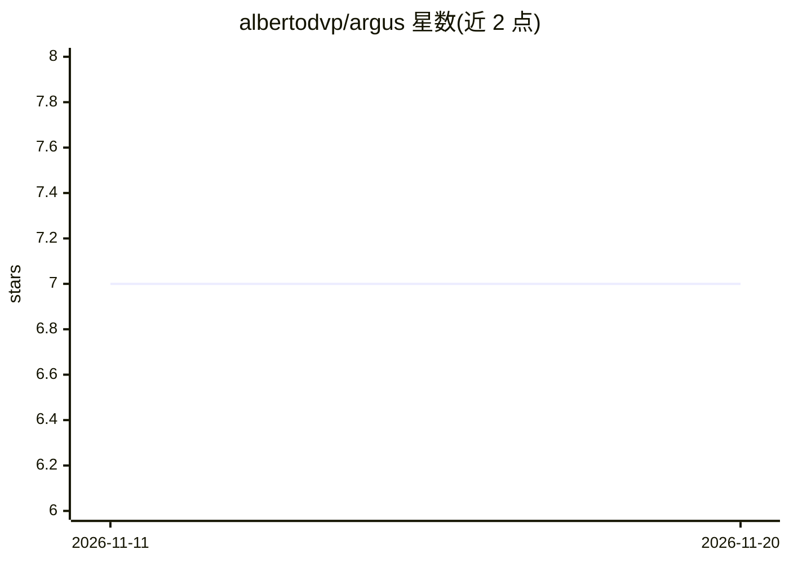

# albertodvp/argus

⭐ 7 · Python · MIT · 推送 2026-11-12 · [GitHub](https://github.com/albertodvp/argus) · 个人维护

**为 Hermes agent 的技能自学习提供意图分组与编辑审查**

Argus 是 Hermes agent 的插件，从使用者一侧读取 agent 的自我技能改写：将跨会话的对话轮按意图分组，把每次 skill 编辑与其来源运行对照打标（来自失败/成功/修正/无证据），并基于多个意图或重复错误生成对 SKILL.md 的最小 diff 提案。所有写入仅在人工显式 apply 后发生，通过 `hermes argus apply` 以 ledger actor `user` 执行。提供 CLI 命令、`/argus` 斜杠命令与仪表盘标签页。derive 阶段按会话与编辑数量产生模型调用，README 提示成本可能较高并建议用 `--since` 限制回填窗口。

## 筛选速览

| 维度 | 判定 | 备注 |
|---|---|---|
| AI 角色 | `ai-ecosystem` | LLM/agent 周边工具 |
| 许可风险 | `permissive` | MIT |
| 部署形态 | `None` |  |
| 模型依赖 | — | README 未给出锁定关系 |
| 硬件要求 | — | 无带数字的原话,不猜 |
| 安装摩擦 | `low` | 无编译、无系统依赖或容器化 |
| 成熟度 | — | 结构信号不足 |

## 能力要点

- 按意图（intent）而非会话分组对话轮，跨会话与跨天聚合
- 每次 skill 编辑对照来源运行打标：from failure/success/correction、no evidence 等
- 基于 2+ 意图或 5+ 次重复错误生成提案，仅显式 apply 时写入技能
- 提供 CLI、`/argus` 斜杠命令与仪表盘 Argus 标签页

## 适用场景

- 审查 Hermes agent 自我改写技能时是否有运行证据支撑
- 按业务意图追踪 agent 多天任务的成功与失败情况
- 在人工确认后再应用 agent 提出的技能规则变更

## 场景标签

`LLM 可观测性` · 领域:评测与运维

## 证据(README 行号)

> L7: Hermes Agent rewrites its own skills while it works. Argus
> L8: is a Hermes plugin that reads that work from the side of the people using the agent:
> L132: |The model that saved a rule also judges it|a separate model slot reads the diff and the run before it, and labels

## 星数曲线

2026-11-11 7 → 2026-11-20 7（+0）

---
*卡片 v1 · prompt 1.4 · 生成 2026-11-20 · 置信度 high · 依据 README sha `93801d36dcf5` · [字段定义](../../DATASET.md)*
