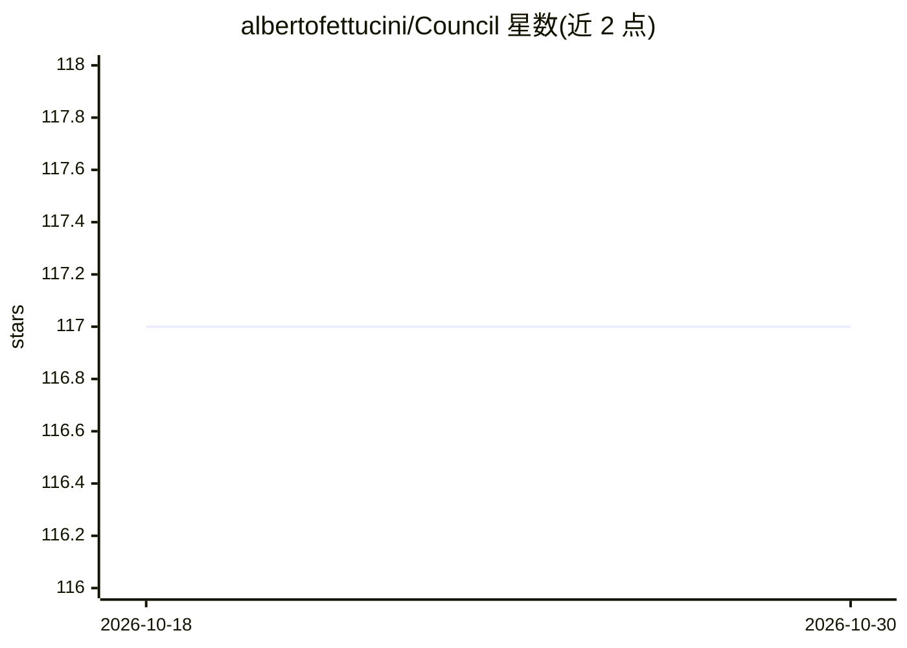

# albertofettucini/Council

⭐ 117 · Swift · MIT · 推送 2026-10-14 · [GitHub](https://github.com/albertofettucini/Council) · 个人维护

**macOS 原生多模型评议应用：多 AI 并行作答、盲评互审并标出分歧**

SwiftUI 编写的 macOS 14+ 原生应用：同一提问并行发给最多三个顾问席位（十二种后端可选，含 OpenAI 兼容自定义端点），各模型独立流式作答后互相匿名盲评，输出 0–100 分歧度、阵营数与离群者答案，可选一轮辩论与中立主持人综合。自带决策日志、访客席位（粘贴外部 AI 回答参与盲评）、CLI 版本与本地历史。自带 API key，无账户无遥测，key 仅存 macOS Keychain。未签名构建，首次启动需手动放行。

## 筛选速览

| 维度 | 判定 | 备注 |
|---|---|---|
| AI 角色 | `ai-native` | 本体是模型或模型工具 |
| 许可风险 | `permissive` | MIT |
| 部署形态 | `None` |  |
| 模型依赖 | local-ok | 支持本地模型 |
| 硬件要求 | — | 无带数字的原话,不猜 |
| 安装摩擦 | `low` | 无编译、无系统依赖或容器化 |
| 成熟度 | — | 结构信号不足 |

## 能力要点

- 同一问题并行询问多模型并流式展示
- 盲评互审 + 0–100 分歧度评分与离群者呈现
- 十二种后端，含 Ollama 本地与自定义 OpenAI 兼容端点
- 附带同引擎 CLI，可输出 JSON 供 CI 使用

## 适用场景

- 对重要问题听取多个模型的独立意见再做决定
- 对比不同模型对同一问题的分歧点
- 在 CI 或脚本中以分歧度作为门禁条件

## 场景标签

`AI 助手` `模型评测` · 领域:对话与助手

## 证据(README 行号)

> L6:  A native macOS app that asks several different models the same question, has them review
> L18: a panel instead. The same prompt goes to several advisors at once — Claude, GPT,
> L43: - 🧠 **Twelve backends** — Claude · GPT (OpenAI) · Gemini · DeepSeek · Grok (xAI) · Mistral · Perplexity · OpenRoute

## 星数曲线

2026-10-18 117 → 2026-10-30 117（+0）

---
*卡片 v1 · prompt 1.4 · 生成 2026-10-23 · 置信度 high · 依据 README sha `6fe0e875c77d` · [字段定义](../../DATASET.md)*
