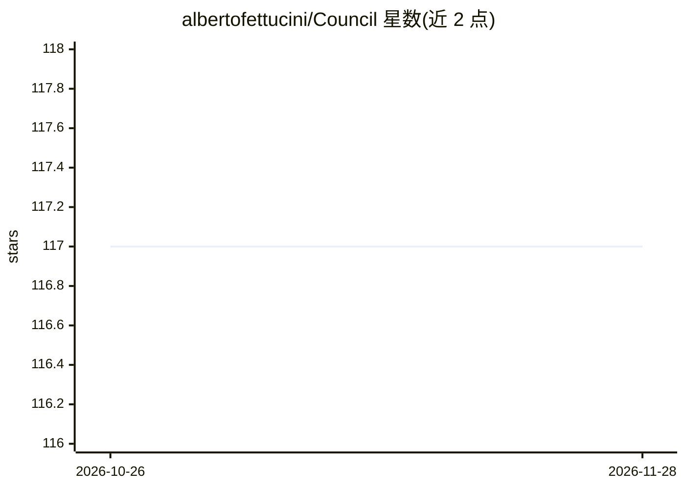

# albertofettucini/Council

⭐ 117 · Swift · MIT · 推送 2026-11-19 · [GitHub](https://github.com/albertofettucini/Council) · 个人维护

**macOS 应用：多模型并行回答、盲评互审、分歧打分，用户自备 API key**

原生 SwiftUI 的 macOS 应用，把同一问题同时发给多个模型（每个席位可选十二种后端），各顾问并行流式作答后互相盲评，给出 0–100 分歧分、阵营划分与离群者答案，并可进行一轮限定辩论与综合。支持客座席位粘贴外部答案、成本统计、决策日志、Markdown/PDF 导出，以及同引擎的 council CLI（可接入 CI）。无账号、无服务器、无遥测，key 存于 macOS 钥匙串，用户直接向各提供商付费。需 macOS 14+，应用未签名，需手动放行。

## 筛选速览

| 维度 | 判定 | 备注 |
|---|---|---|
| AI 角色 | `ai-native` | 本体是模型或模型工具 |
| 许可风险 | `permissive` | MIT |
| 部署形态 | `None` |  |
| 模型依赖 | local-ok | 支持本地模型 |
| 硬件要求 | — | 无带数字的原话,不猜 |
| 安装摩擦 | `low` | 无编译、无系统依赖或容器化 |
| 成熟度 | — | 结构信号不足 |

## 能力要点

- 十二种后端：Claude/GPT/Gemini/DeepSeek/Grok/Mistral/Perplexity/OpenRouter/Ollama/Apple Intelligence/两个自定义 OpenAI 兼容端点
- 盲评互审与 0–100 分歧分，突出离群者答案而非取平均
- API key 仅存 macOS 钥匙串，无账号、无服务器、无遥测
- 附带 council CLI（CouncilKit），支持管道输入文档、输出 JSON

## 适用场景

- 向多个模型提问后比较分歧，看少数派意见
- 让模型互相盲评以减少单一模型的盲区
- 在 CI 中用 CLI 按分歧分做门禁
- 把已获得的 ChatGPT/Claude 答案粘入客座席位参与评审

## 场景标签

`AI 助手` · 领域:对话与助手

## 证据(README 行号)

> L5:  Several AIs answer. Council shows you where they disagree.
> L49: - 🧠 **Twelve backends** — Claude · GPT (OpenAI) · Gemini · DeepSeek · Grok (xAI) · Mistral · Perplexity · OpenRoute

## 星数曲线

2026-10-26 117 → 2026-11-28 117（+0）

---
*卡片 v1 · prompt 1.4 · 生成 2026-11-28 · 置信度 high · 依据 README sha `29a9be012b4c` · [字段定义](../../DATASET.md)*
