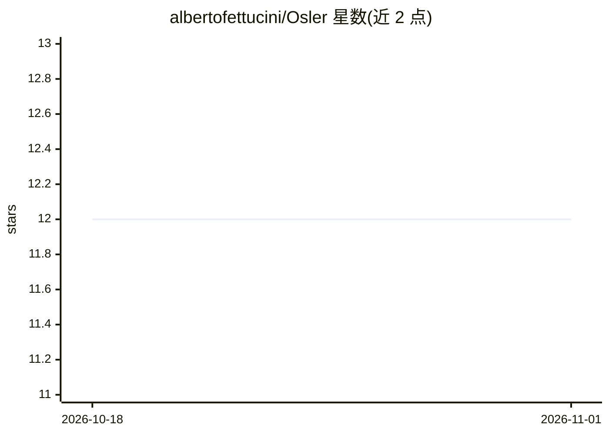

# albertofettucini/Osler

⭐ 12 · Swift · MIT · 推送 2026-10-14 · [GitHub](https://github.com/albertofettucini/Osler) · 个人维护

**Mac 本地画布式 AI 工作流应用：节点编排、可重复运行**

面向 macOS 的原生应用：用户在画布上以四种节点（Input/Agent/Condition/Output）编排 LLM 步骤，按 Run 顺序执行并流式输出，各步骤可指定不同模型。模型接入 Anthropic Messages API、OpenAI Chat Completions 与本地 Ollama（完全离线），API key 存于 macOS Keychain。Agent 节点可调用 stdio MCP 服务器的工具，无账号、无云端、无遥测，流程保存为 .oslerflow JSON 文件。提供 .dmg 下载与 Swift 源码构建两种安装方式，附 8 个起始模板与 headless CLI。限制：仅支持 stdio MCP 服务器，工具调用目前不预先询问用户。

## 筛选速览

| 维度 | 判定 | 备注 |
|---|---|---|
| AI 角色 | `ai-native` | 本体是模型或模型工具 |
| 许可风险 | `permissive` | MIT |
| 部署形态 | `desktop` | 安装包/桌面程序 |
| 模型依赖 | local-ok | 支持本地模型 |
| 硬件要求 | — | 无带数字的原话,不猜 |
| 安装摩擦 | `low` | 无编译、无系统依赖或容器化 |
| 成熟度 | — | 结构信号不足 |

## 能力要点

- 四种节点类型构成完整流程词汇表，独立分支并发执行
- 支持 Anthropic/OpenAI API key 与本地 Ollama 离线模型，各步骤可用不同模型
- Agent 节点可调用 stdio MCP 服务器工具
- 流程为纯 JSON 文件（.oslerflow），无账号无云端无遥测

## 适用场景

- 把已知的重复 AI 小任务（总结、校对、起草回复）固化为可复现流程
- 在本地 Mac 上离线跑 LLM 工作流，不经云端服务
- 通过 MCP 工具让流程中的 Agent 访问文件、网页或 API

## 场景标签

`工作流自动化` · 领域:效率与自动化

## 证据(README 行号)

> L5: Osler is a Mac app for small AI jobs you already know how to do: summarize
> L6: this, check that, draft the reply. You lay the steps out as nodes on a canvas,
> L11: Claude, GPT and local models through Ollama can share one

## 星数曲线

2026-10-18 12 → 2026-11-01 12（+0）

---
*卡片 v1 · prompt 1.4 · 生成 2026-11-01 · 置信度 mid · 依据 README sha `211397ae11b4` · [字段定义](../../DATASET.md)*
