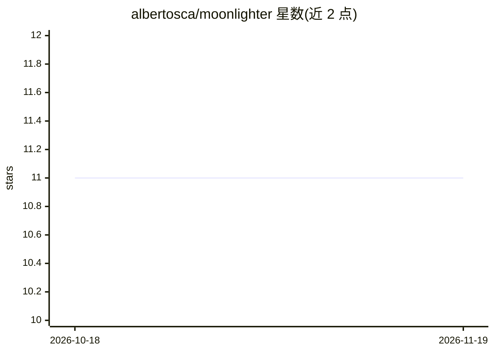

# albertosca/moonlighter

⭐ 11 · Python · AGPL-3.0 · 推送 2026-11-18 · [GitHub](https://github.com/albertosca/moonlighter) · [官网](https://albertosca.github.io/moonlighter/) · 个人维护

**自托管求职助手：扫描职位、按简历打分并起草答题表**

面向求职者的自托管 MCP 服务器与 JSON CLI：按公司列表扫描 Greenhouse、Lever、Ashby、Recruitee、Workable、SmartRecruiters、InHire 七个招聘板，LLM 对照个人资料对职位评分，低于阈值归档；为申请表每道题起草答案供人工粘贴发送，可生成针对职位的单页 LaTeX CV，并通过 Gmail +alias 匹配追踪回复。数据存于本地 SQLite，设计上从不自动发送申请，薪资/合规/人口学问题由守卫机制留给用户回答。

## 筛选速览

| 维度 | 判定 | 备注 |
|---|---|---|
| AI 角色 | `ai-native` | 本体是模型或模型工具 |
| 许可风险 | `dual` | AGPL-3.0 |
| 部署形态 | `library` | 以包/库形式分发 |
| 模型依赖 | locked-api |  |
| 硬件要求 | — | 无带数字的原话,不猜 |
| 安装摩擦 | `low` | 无编译、无系统依赖或容器化 |
| 成熟度 | — | 结构信号不足 |

## 能力要点

- 扫描 7 个招聘板来源并对职位 LLM 评分
- 起草完整答题表，无法回答处标记 UNKNOWN 交还用户
- 本地 SQLite 存储流水线，从不代发申请
- 19 个 MCP 工具，可经 Claude Code 插件或任意 MCP 客户端调用

## 适用场景

- 批量扫描目标公司的新职位并筛选适合的岗位
- 让 AI 基于自己的资料起草申请表答案，人工审核后发送
- 通过邮件别名自动追踪招聘方回复、推进申请流程

## 场景标签

`工作流自动化` · 领域:效率与自动化

## 证据(README 行号)

> L28:  moonlighter scans, scores and drafts; only you paste and send the application
> L31: - **Evaluate** — an LLM scores each posting against your profile; postings below your threshold are archived.
> L59: You need uv (it fetches Python 3.14 for you) and an LLM backend: the Claude Code CLI by default, or an Anthropic AP

## 星数曲线

2026-10-18 11 → 2026-11-19 11（+0）

---
*卡片 v1 · prompt 1.4 · 生成 2026-11-18 · 置信度 high · 依据 README sha `41d7a7e33a60` · [字段定义](../../DATASET.md)*
