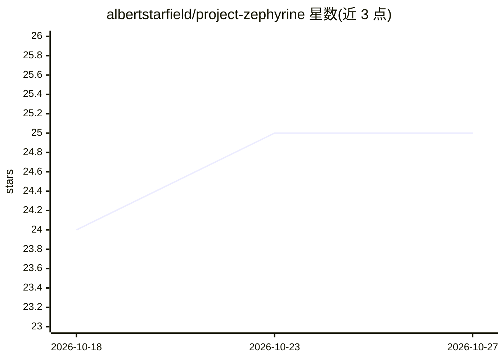

# albertstarfield/project-zephyrine

⭐ 25 · Ada · NOASSERTION · 推送 2026-09-11 · [GitHub](https://github.com/albertstarfield/project-zephyrine) · [官网](http://zephyrinefoundation.com/zephyrine) · 组织维护

**面向无人机与航天器的自适应 GNC 认知框架系统**

运行在飞行器嵌入式硬件上的自适应制导导航控制（GNC）框架：包含认知架构 Snowball-Enaga（从每次飞行学习飞行员偏好与任务模式）与实时决策引擎 Volatus Damarae。核为 Ada/SPARK，支持部署到 NuttX/Zephyr RTOS，通过 MAVLink/UDP/ROS2 DDS 连接 PX4 SITL、X-Plane、FlightGear、Gazebo、AirSim 等仿真环境，集成 cFS 做遥测与指令路由。安装后无网络依赖，运行于 localhost 服务。README 声明本系统非自动驾驶仪也非通用聊天 AI，需要用户深度参与训练。

## 筛选速览

| 维度 | 判定 | 备注 |
|---|---|---|
| AI 角色 | `ai-native` | 本体是模型或模型工具 |
| 许可风险 | `none` | NOASSERTION |
| 部署形态 | `None` |  |
| 模型依赖 | local-ok | 支持本地模型 |
| 硬件要求 | — | 无带数字的原话,不猜 |
| 安装摩擦 | `low` | 无编译、无系统依赖或容器化 |
| 成熟度 | `idea` | |

## 能力要点

- 认知架构学习飞行员任务偏好与飞行模式（跨飞行保留知识）
- Ada/SPARK 核心实现形式化验证与内存安全
- 支持 PX4 SITL / X-Plane / FlightGear / Gazebo / AirSim 五类仿真器连接
- 提供 OpenAI / Ollama / Anthropic 兼容的 Cognitive API 端点

## 适用场景

- 无人机任务中作为地面站与飞控之间的认知决策层
- 通过 PX4 SITL 仿真进行软件在环飞行测试
- 深空探测器等通信延迟场景下的板载自适应决策

## 场景标签

 · 领域:航空航天/嵌入式控制系统

## 证据(README 行号)

> L12: I'm a **adaptive GNC system** designed to live inside unmanned aircraft and spacecraft probes.
> L24: **Volatus Damarae** — My real-time decision engine. Deterministic when safety demands it. Dynamic when creativity i
> L40: |**Navigation**|Contextual state estimation. Not just coordinates — *what those coordinates mean* relative to missi

## 星数曲线

2026-10-18 24 → 2026-10-27 25（+1）

---
*卡片 v1 · prompt 1.4 · 生成 2026-10-27 · 置信度 mid · 依据 README sha `182d18f923c0` · [字段定义](../../DATASET.md)*
