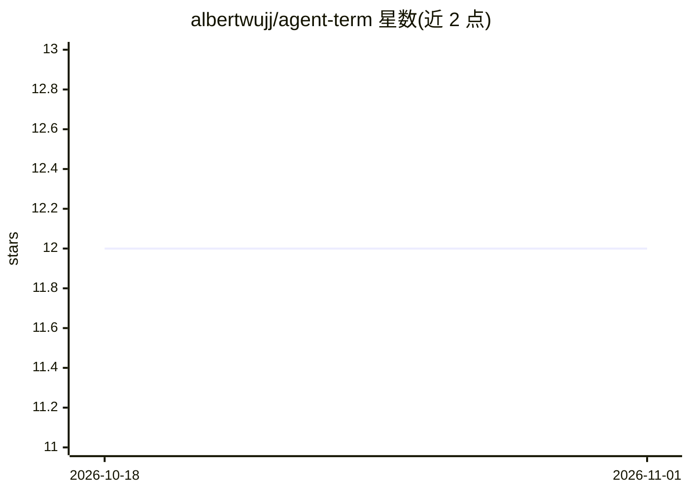

# albertwujj/agent-term

⭐ 12 · JavaScript · MIT · 推送 2026-10-31 · [GitHub](https://github.com/albertwujj/agent-term) · 个人维护

**把 AI CLI 会话变成可视化工作区的 Electron 终端**

面向使用多个编码代理（Claude Code、Codex、Cursor CLI、Copilot CLI 等）的开发者的终端应用：在完整终端中运行现有 AI CLI，每个会话独立 OS 窗口与任务栏标识，并通过解析终端输出中的文件引用与文本约定，提供 Markdown 文档渲染与批注、代码审查（review://）、会话恢复、检出锁、长任务完成通知、手机访问与语音回复等功能。基于 Electron + xterm.js + node-pty，不依赖厂商 SDK；支持从源码运行与修改。macOS 与 Windows/WSL 可用，手机与 IDE 集成需单独配置。

## 筛选速览

| 维度 | 判定 | 备注 |
|---|---|---|
| AI 角色 | `ai-ecosystem` | LLM/agent 周边工具 |
| 许可风险 | `permissive` | MIT |
| 部署形态 | `None` |  |
| 模型依赖 | — | README 未给出锁定关系 |
| 硬件要求 | — | 无带数字的原话,不猜 |
| 安装摩擦 | `low` | 无编译、无系统依赖或容器化 |
| 成熟度 | — | 结构信号不足 |

## 能力要点

- 每个代理会话独立 OS 窗口与唯一任务栏标识
- Markdown 文档渲染、段落批注与就地修订（含变更高亮）
- 基于文本约定解析的代管式代码审查与 review:// 引用
- 跨机器手机访问与语音回复（需单独配置）

## 适用场景

- 同时运行多个 AI 编码代理并快速区分和切换会话
- 在渲染页面中批注计划文档并让代理就地修订
- 远程通过手机查看各机器上代理状态并语音回复

## 场景标签

`代码审查` · 领域:编码与开发

## 证据(README 行号)

> L3: AgentTerm is a full terminal where your existing and new AI CLI sessions run as usual. But it turns each session's t
> L50: Some terminals combine support for AI CLIs with an agent and platform of their own. AgentTerm's whole purpose is to
> L96: AgentTerm runs your existing AI CLI in a full terminal, using Electron for the window, xterm.js for terminal emulat

## 星数曲线

2026-10-18 12 → 2026-11-01 12（+0）

---
*卡片 v1 · prompt 1.4 · 生成 2026-11-01 · 置信度 high · 依据 README sha `747154e56d1f` · [字段定义](../../DATASET.md)*
