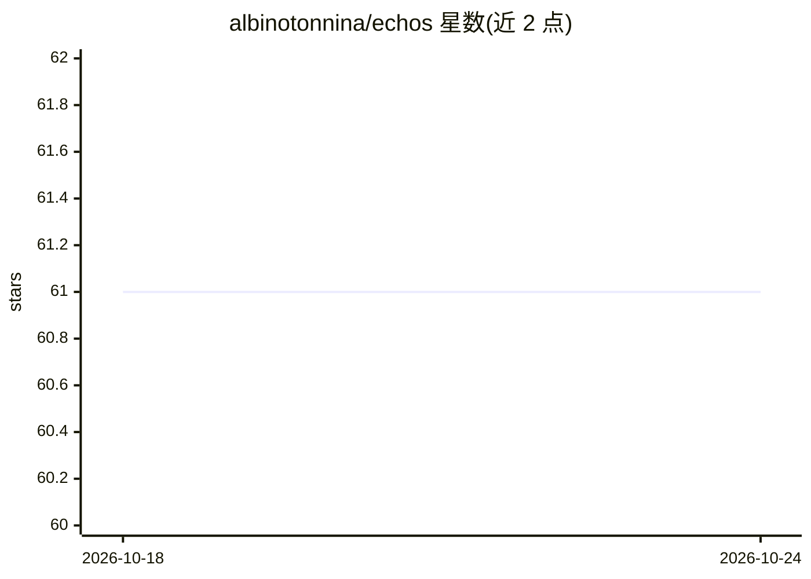

# albinotonnina/echos

⭐ 61 · TypeScript · MIT · 推送 2026-07-12 · [GitHub](https://github.com/albinotonnina/echos) · [官网](https://www.echos.sh) · 个人维护

**自托管的个人 AI 知识系统：对话式捕获、搜索与写作**

单用户自托管的个人知识系统，通过 Telegram、终端或网页以自然对话方式捕获文本、URL、语音与照片，自动转录、分类、打标签并存为纯 Markdown 文件，兼容 Obsidian 双向同步。提供混合全文+语义搜索（含时间衰减、热度评分、可选 AI 重排）、基于个人笔记的写作生成与 MCP server。需配置 LLM API key（Anthropic 或任意 OpenAI 兼容端点，含本地 Ollama），明确不支持多租户。

## 筛选速览

| 维度 | 判定 | 备注 |
|---|---|---|
| AI 角色 | `ai-native` | 本体是模型或模型工具 |
| 许可风险 | `permissive` | MIT |
| 部署形态 | `library` | 以包/库形式分发 |
| 模型依赖 | local-ok | 支持本地模型 |
| 硬件要求 | — | 无带数字的原话,不猜 |
| 安装摩擦 | `low` | 无编译、无系统依赖或容器化 |
| 成熟度 | — | 结构信号不足 |

## 能力要点

- Telegram/终端/网页多通道对话式捕获，自动转录分类打标签
- 混合全文+语义搜索，含时间衰减、热度评分与可选 AI 重排
- 笔记为纯 Markdown，与 Obsidian 双向实时同步
- 内置 MCP server，可连接 Claude Code、Cursor 等 AI 工具

## 适用场景

- 把随手想到的内容和文章通过 Telegram 存入个人知识库
- 用自然语言提问检索自己的历史笔记
- 让 AI 基于自己的笔记风格写博客、邮件或推文串

## 场景标签

`知识库管理` `语义搜索` `AI 助手` `AI 写作` · 领域:对话与助手

## 证据(README 行号)

> L5: **Your personal AI knowledge system — self-hosted, agent-driven, and always private.**
> L49: **Capture without friction.** Text, URLs, voice messages, photos — through Telegram, the terminal, or the web. It f
> L114: You'll need an LLM API key — either Anthropic (`ANTHROPIC_API_KEY`, pay-as-you-go, not a Claude subscription) or a

## 星数曲线

2026-10-18 61 → 2026-10-24 61（+0）

---
*卡片 v1 · prompt 1.4 · 生成 2026-10-24 · 置信度 mid · 依据 README sha `4f1ec584c9bf` · [字段定义](../../DATASET.md)*
