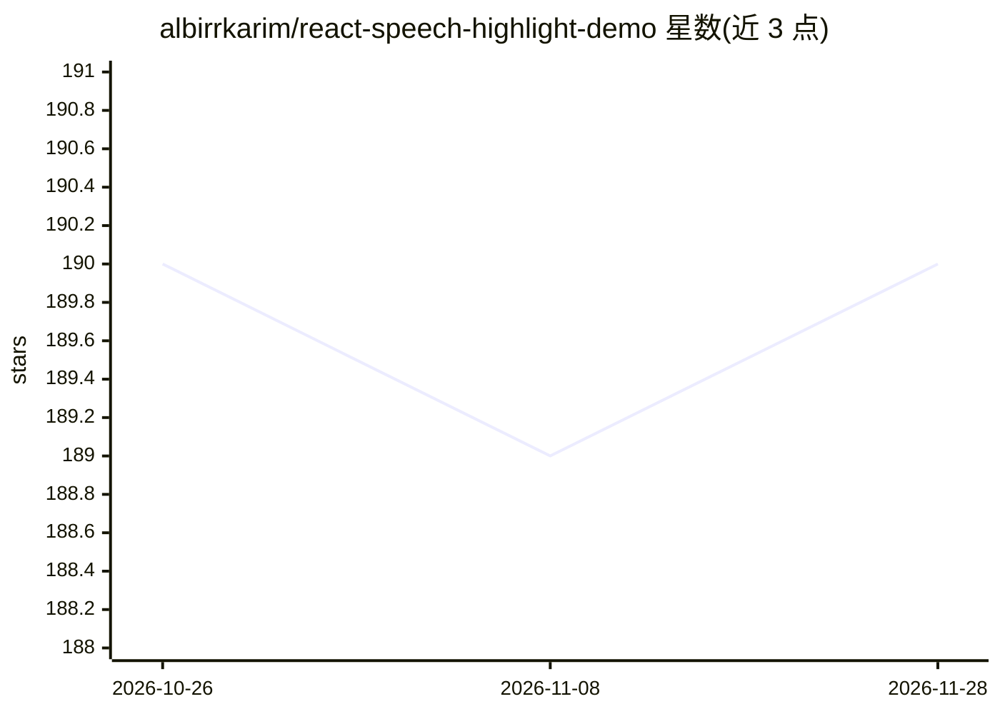

# albirrkarim/react-speech-highlight-demo

⭐ 190 · JavaScript · NOASSERTION · 推送 2026-11-11 · [GitHub](https://github.com/albirrkarim/react-speech-highlight-demo) · [官网](https://react-speech-highlight.vercel.app) · 个人维护

**给 Web/React 开发者提供朗读时同步高亮词句的 TTS 库**

一个 React/Vanilla JS/React Native 库，在网页中接入文本转语音并同步高亮正在朗读的单词与句子。支持三种音频来源：Web SpeechSynthesis、音频文件（mp3 等）、以及 ElevenLabs/OpenAI 等流式 TTS API，全部逻辑在客户端运行，无需后端。附带示例覆盖 YouTube 字幕高亮、3D 头像口型（viseme）、双语字幕、发音纠正（调用 OpenAI API）、语言检测等。6.0 版本不再修改页面 DOM，通过隐藏副本叠加高亮。为付费购买制，购买含示例源码。

## 筛选速览

| 维度 | 判定 | 备注 |
|---|---|---|
| AI 角色 | `ai-enhanced` | 去掉 AI 部分产品仍成立 |
| 许可风险 | `none` | NOASSERTION |
| 部署形态 | `None` |  |
| 模型依赖 | — | README 未给出锁定关系 |
| 硬件要求 | — | 无带数字的原话,不猜 |
| 安装摩擦 | `low` | 无编译、无系统依赖或容器化 |
| 成熟度 | — | 结构信号不足 |

## 能力要点

- 客户端检测音频中正在朗读的词/句并同步高亮
- 支持 Web SpeechSynthesis、音频文件与流式 TTS API 三类音源
- 提供 viseme 口型状态、关系高亮、SSR 支持
- React / Vanilla JS / React Native 三个实现版本

## 适用场景

- 给长文章加 TTS 朗读按钮并显示阅读进度
- 语言学习应用使用真人录音逐词高亮
- 3D AI 头像/NPC 的口型与语音同步
- 为 YouTube 转录做词级关联高亮

## 场景标签

`语音合成` · 领域:内容生成

## 证据(README 行号)

> L5: **React / Vanilla Speech Highlight** is a powerful library for integrating **text-to-speech** and **real-time word/s
> L91: My package combines Built in Web SpeechSynthesis and Audio File (optional) to run.
> L99: How does this package know the timing of spoken words or sentences in played audio? This package can detect the spo

## 星数曲线

2026-10-26 190 → 2026-11-28 190（+0）

---
*卡片 v1 · prompt 1.4 · 生成 2026-11-26 · 置信度 high · 依据 README sha `536a708687e5` · [字段定义](../../DATASET.md)*
