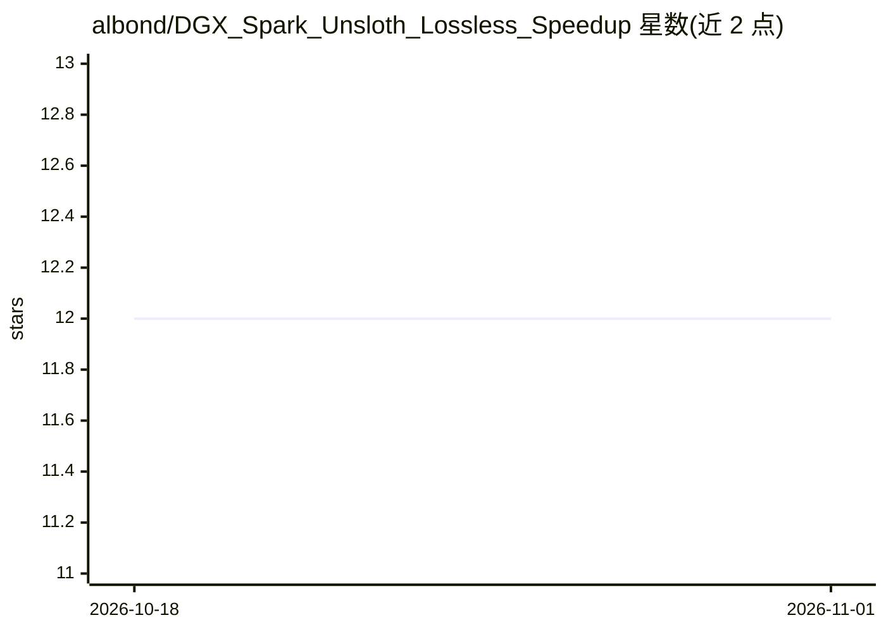

# albond/DGX_Spark_Unsloth_Lossless_Speedup

⭐ 12 · Python · MIT · 推送 2026-05-19 · [GitHub](https://github.com/albond/DGX_Spark_Unsloth_Lossless_Speedup) · 个人维护

**在 DGX Spark 上加速 Qwen3.5 微调的训练工具（LoRA 7.67×）**

面向 NVIDIA DGX Spark（GB10，sm_121a）用户的 Unsloth 训练加速项目：用 vanilla-PyTorch 循环和 sm_121a 感知的 Triton 内核替换未优化训练路径，实测在多模态 Qwen3.5-2B 上 LoRA 提速 7.67×、全量微调 8.35×，损失曲线在 BF16 精度内与未优化参考逐位一致。提供三命令交互式向导，覆盖 Docker 构建、模型选择、数据校验、训练与合并，并可选挂载 MTP 推测头（输出 vllm serve 可用）。支持 0.8B–27B 五个 Qwen3.5 尺寸及自定义 Qwen 兼容模型；提速数字以 2B 为锚，未在其他模型上逐一验证。

## 筛选速览

| 维度 | 判定 | 备注 |
|---|---|---|
| AI 角色 | `ai-ecosystem` | LLM/agent 周边工具 |
| 许可风险 | `permissive` | MIT |
| 部署形态 | `self-host` | docker 或自建部署 |
| 模型依赖 | local-ok | 支持本地模型 |
| 硬件要求 | — | 无带数字的原话,不猜 |
| 安装摩擦 | `low` | 无编译、无系统依赖或容器化 |
| 成熟度 | — | 结构信号不足 |

## 能力要点

- LoRA 7.67× / Full FT 8.35× 提速，损失曲线 BF16 内逐位一致（逐步 A/B 验证）
- 三命令向导：Docker 构建→选模型→数据校验→训练→合并
- 支持 Qwen3.5 0.8B–27B 五档及 Qwen 兼容自定义模型（校验 model_type 与线性层命名）
- 可选 MTP 推测头，输出 vllm serve 可用的无损推理提速

## 适用场景

- 在自有 DGX Spark 上对 Qwen3.5 做小模型专才微调，避免租用 H100
- 用自有交互数据反复迭代训练小型专家模型
- 在本地硬件上完成微调，训练数据不出本机

## 场景标签

`微调` · 领域:训练与推理

## 证据(README 行号)

> L11: **Train Qwen3.5 fine-tunes on NVIDIA DGX Spark at wall-clock parity with a rented H100 — on hardware you already ow
> L78: - Replace the unoptimized Unsloth training path with a vanilla-PyTorch loop and sm_121a-aware Triton kernels.
> L106: Measured on a real NVIDIA DGX Spark (GB10, sm_121a). All numbers eager-mode, batch size 1, single GPU. Anchor row 

## 星数曲线

2026-10-18 12 → 2026-11-01 12（+0）

---
*卡片 v1 · prompt 1.4 · 生成 2026-11-01 · 置信度 mid · 依据 README sha `c15d45c04559` · [字段定义](../../DATASET.md)*
