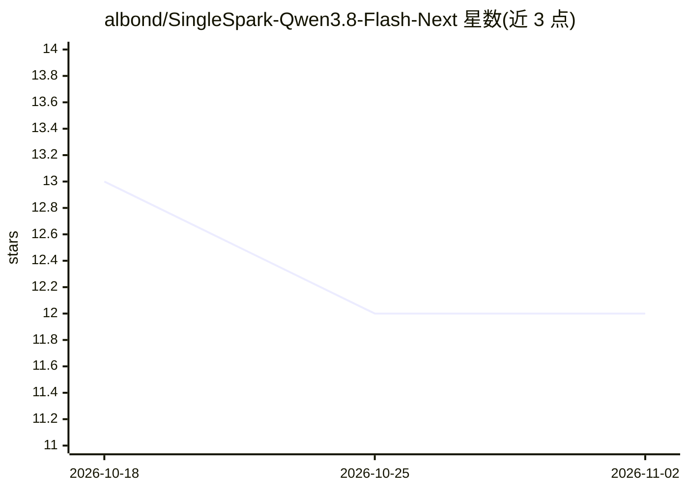

# albond/SingleSpark-Qwen3.8-Flash-Next

⭐ 12 · Python · MIT · 推送 2026-09-03 · [GitHub](https://github.com/albond/SingleSpark-Qwen3.8-Flash-Next) · 个人维护

**在单台 DGX Spark 上以 NVFP4+FP8 混合量化运行 Qwen3.8-Flash-Next 的服务方案**

面向单张 NVIDIA DGX Spark（GB10，128GB 统一内存）的 Qwen3.8-Flash-Next（约180B 参数 MoE）推理服务项目。通过四比特 NVFP4 checkpoint 加块级 FP8 转换、FP8 输出投影与乘积量化投机头，使超出 128GB 的模型装入单机，实测单流约 43 tok/s（65,536 上下文）。提供 install.sh 一键安装，服务以 vLLM 容器镜像运行并暴露 OpenAI API；量化质量代价以 teacher-forced NLL（+0.003277 nat/token，阈值 +0.005）与 210 题准确率探针发布。明确声明未测量并发服务、满窗长请求、多模态与长工具链 agentic 准确率。

## 筛选速览

| 维度 | 判定 | 备注 |
|---|---|---|
| AI 角色 | `ai-ecosystem` | LLM/agent 周边工具 |
| 许可风险 | `permissive` | MIT |
| 部署形态 | `library` | 以包/库形式分发 |
| 模型依赖 | local-ok | 支持本地模型 |
| 硬件要求 | — | 无带数字的原话,不猜 |
| 安装摩擦 | `medium` | 含编译或系统依赖之一 |
| 成熟度 | `idea` | |

## 能力要点

- NVFP4 + 块级 FP8 混合量化使 172.78 GiB 的 FP8 checkpoint 装入 128GB 统一内存
- 单流 43.34 tok/s（跨 prompt 中位数）、65,536 token 上下文、投机深度 3
- 量化质量代价有预登记阈值的测量：NLL +0.003277 nat/token、9/9 贪婪复读一致
- 容器镜像按 digest 锁定，依赖变更在构建期失败而非推理期

## 适用场景

- 在单台 DGX Spark 上本地运行 180B MoE 模型并通过 OpenAI API 供聊天客户端或 agent 框架调用
- 需要为量化取舍拿到已发布测量的部署者
- 复现或审查该项目公布的吞吐与质量测量结果

## 场景标签

`推理引擎` `模型量化` · 领域:训练与推理

## 证据(README 行号)

> L16: One command installs it. It speaks the OpenAI API, so any chat client, agent
> L17: framework or IDE plugin that already talks to OpenAI talks to this.
> L182: |base image|`vllm/vllm-openai@sha256:3b0e188f…54477e` (arm64)|
> L183: |vLLM|0.1.dev20073+g8e685d198|

## 星数曲线

2026-10-18 13 → 2026-11-02 12（-1）

---
*卡片 v1 · prompt 1.4 · 生成 2026-11-01 · 置信度 mid · 依据 README sha `6377a374bc8b` · [字段定义](../../DATASET.md)*
