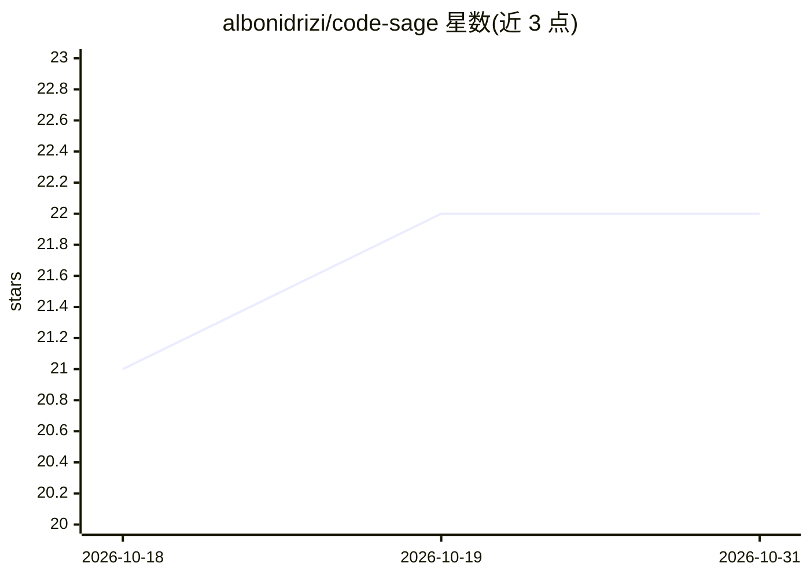

# albonidrizi/code-sage

⭐ 22 · Java · MIT · 推送 2026-06-20 · [GitHub](https://github.com/albonidrizi/code-sage) · 个人维护

**异步 GitHub PR 代码审查服务，接入 OpenAI/Claude 生成反馈**

GitHub Pull Request 异步审查服务的参考实现：校验 GitHub webhook（HMAC-SHA256）、用 PostgreSQL 去重防重复审查、经 RabbitMQ 排队与死信队列调度分析任务，调用 OpenAI、Claude 或确定性 demo 分析器产出审查结果，持久化发现并通过 React 仪表盘展示，同时暴露 Micrometer/Prometheus 指标。README 声明为作品集/参考项目，非托管生产服务；无公开部署、发布版本或演示视频，远程调用需 API key，无密钥时仅支持确定性 demo 路径。通过 Docker Compose 运行演示。

## 筛选速览

| 维度 | 判定 | 备注 |
|---|---|---|
| AI 角色 | `ai-native` | 本体是模型或模型工具 |
| 许可风险 | `permissive` | MIT |
| 部署形态 | `self-host` | docker 或自建部署 |
| 模型依赖 | locked-api |  |
| 硬件要求 | — | 无带数字的原话,不猜 |
| 安装摩擦 | `low` | 无编译、无系统依赖或容器化 |
| 成熟度 | `idea` | |

## 能力要点

- OpenAI 与 Claude 适配器，含确定性 demo 回退
- PostgreSQL 去重 + RabbitMQ 重试与死信队列的异步审查流水线
- Micrometer/Prometheus 审查/提供方/队列/token/成本指标
- React 审查指挥中心仪表盘

## 适用场景

- 自动审查 GitHub PR 并在仪表盘查看 AI 反馈
- 作为异步 webhook 服务与队列化分析的参考实现学习
- 观察审查、token 与成本等 Prometheus 指标

## 场景标签

`代码审查` · 领域:编码与开发

## 证据(README 行号)

> L6: CodeSage is a reference implementation of an asynchronous pull-request review service. It validates GitHub webhooks,
> L7: queues review work, prevents duplicate reviews, runs OpenAI, Claude, or deterministic demo analysis providers,
> L17: - OpenAI and Claude provider adapters with deterministic demo fallback

## 星数曲线

2026-10-18 21 → 2026-10-31 22（+1）

---
*卡片 v1 · prompt 1.4 · 生成 2026-10-27 · 置信度 high · 依据 README sha `41b192d6871d` · [字段定义](../../DATASET.md)*
