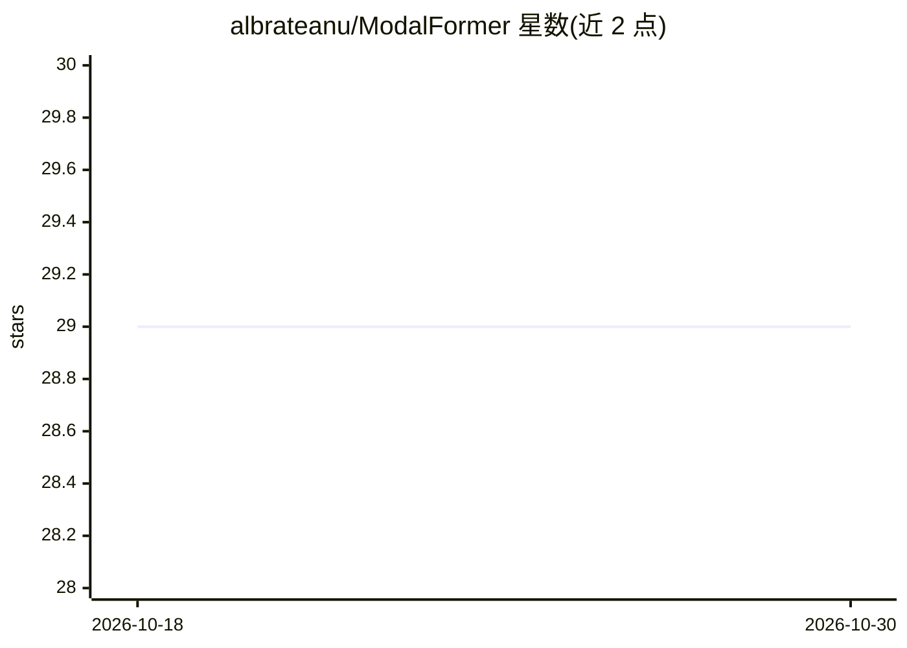

# albrateanu/ModalFormer

⭐ 29 · Python · MIT · 推送 2026-04-14 · [GitHub](https://github.com/albrateanu/ModalFormer) · [官网](https://arxiv.org/abs/2507.20388) · 组织维护

**多模态 Transformer 低光照图像增强模型，论文官方代码与预训练权重**

ModalFormer 是低光照图像增强（LLIE）的多模态 Transformer 框架官方实现：核心为 Cross-modal Transformer（CM-T）与多个辅助子网络，通过 Cross-modal Multi-headed Self-Attention（CM-MSA）融合 RGB 与九种辅助模态特征（深度特征、分割信息、几何线索、颜色信息）生成混合注意力图。仓库提供预训练模型、测试代码与 LOL-v1、LOL-v2（Synthetic/Real）、SDSD（indoor/outdoor）测试数据（经 Google Drive 分发），通过 shell 脚本搭建环境后用 python 脚本推理，结果输出到 results/ValSet。推荐 Linux + CUDA GPU（至少 4GB VRAM），CPU 可运行但耗时。

## 筛选速览

| 维度 | 判定 | 备注 |
|---|---|---|
| AI 角色 | `ai-native` | 本体是模型或模型工具 |
| 许可风险 | `permissive` | MIT |
| 部署形态 | `None` |  |
| 模型依赖 | — | README 未给出锁定关系 |
| 硬件要求 | — | 无带数字的原话,不猜 |
| 安装摩擦 | `medium` | 含编译或系统依赖之一 |
| 成熟度 | — | 结构信号不足 |

## 能力要点

- Cross-modal Transformer（CM-T）融合 RGB 与九种辅助模态
- CM-MSA 注意力机制生成混合注意力图
- 提供预训练模型与四个基准数据集的测试数据
- 支持参数量统计与模型结构打印的测试参数

## 适用场景

- 在 LOL/SDSD 基准数据集上复现论文推理结果
- 对低光照图像执行增强推理并生成可视化结果
- 基于预训练权重做低光照增强相关研究与实验对比

## 场景标签

`图像视频处理` · 领域:感知与多模态

## 证据(README 行号)

> L10: *Low-light image enhancement (LLIE) is a fundamental yet challenging task due to the presence of noise, loss of det
> L18: This repository contains pre-trained versions of ModalFormer, alongside all necessary code and data for testing and

## 星数曲线

2026-10-18 29 → 2026-10-30 29（+0）

---
*卡片 v1 · prompt 1.4 · 生成 2026-10-26 · 置信度 high · 依据 README sha `76c126116bfe` · [字段定义](../../DATASET.md)*
