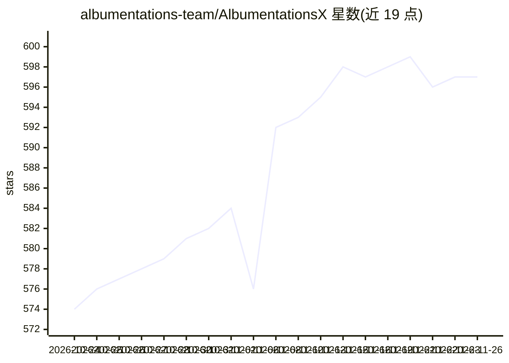

# albumentations-team/AlbumentationsX

⭐ 597 · Python · AGPL-3.0 · 推送 2026-11-25 · [GitHub](https://github.com/albumentations-team/AlbumentationsX) · [官网](https://albumentations.ai/pricing) · 组织维护

**面向 CV 开发者的图像与标注增强库，覆盖 2D/3D/医学**

Python 图像增强库，从现有数据生成新训练样本用于深度学习与计算机视觉任务。统一 API 处理 RGB/灰度/多光谱图像、掩码、边界框（含 OBB）、关键点及 3D 体数据；内置 70+ 像素级变换、空间级变换、医学变换（GibbsRinging、HEStain 等）与 3D 变换，支持 PyTorch、TensorFlow 等框架。要求 Python 3.11+，需自行安装匹配的 PyTorch 构建。默认采集使用统计数据，可关闭。

## 筛选速览

| 维度 | 判定 | 备注 |
|---|---|---|
| AI 角色 | `ai-native` | 本体是模型或模型工具 |
| 许可风险 | `dual` | AGPL-3.0 |
| 部署形态 | `library` | 以包/库形式分发 |
| 模型依赖 | — | README 未给出锁定关系 |
| 硬件要求 | — | 无带数字的原话,不猜 |
| 安装摩擦 | `medium` | 含编译或系统依赖之一 |
| 成熟度 | — | 结构信号不足 |

## 能力要点

- 70+ 像素级与空间级增强，统一 API 覆盖图像/掩码/边界框/关键点
- 含医学采集伪影与组织染色增强模块及 3D 体数据变换
- 提供 MCP 集成，可在 Claude Desktop/Cursor 等宿主中审查与导出流水线
- 双许可：AGPL-3.0-only 或商业许可

## 适用场景

- 为图像分类和检测任务扩充训练数据
- 分割标注与边界框随图像同步变换
- 医学影像数据的体数据增强
- 训练前对不同模态图像做统一预处理增强

## 场景标签

`图像视频处理` · 领域:感知与多模态

## 证据(README 行号)

> L14: **AlbumentationsX** is a Python library for image augmentation. It provides high-performance, robust implementation
> L70: - **Simple, Unified API**: One consistent interface for all data types - RGB/grayscale/multispectral images, masks,
> L73: - **Deep Learning Integration**: Works with PyTorch, TensorFlow, and other frameworks. Part of the PyTorch ecosyste

## 星数曲线

2026-10-24 574 → 2026-11-26 597（+23）

---
*卡片 v1 · prompt 1.4 · 生成 2026-11-25 · 置信度 high · 依据 README sha `db186c5ab149` · [字段定义](../../DATASET.md)*
