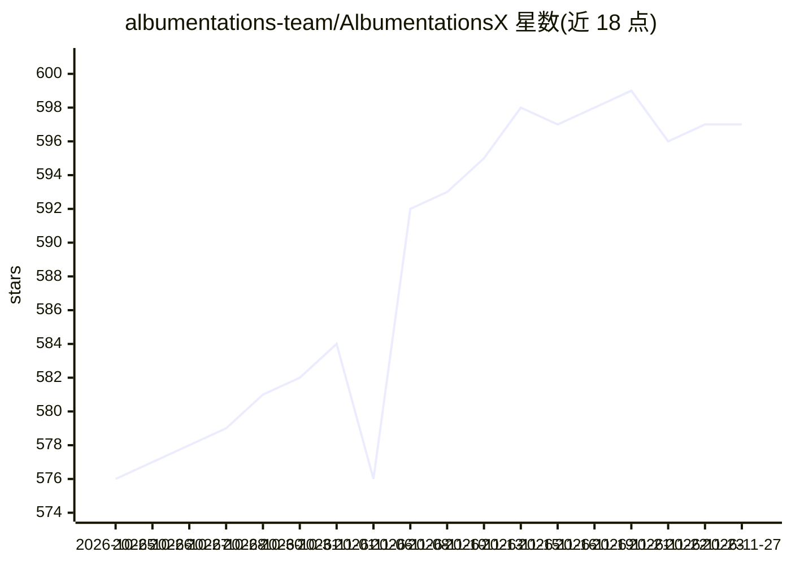

# albumentations-team/AlbumentationsX

⭐ 597 · Python · AGPL-3.0 · 推送 2026-11-26 · [GitHub](https://github.com/albumentations-team/AlbumentationsX) · [官网](https://albumentations.ai/pricing) · 组织维护

**面向 CV 开发者的图像增强 Python 库，统一处理图像与标注**

Python 图像增强库，为深度学习训练生成新样本。支持像素级与空间级 70+ 种变换，统一接口处理 RGB/灰度/多光谱图像、掩码、边界框（含 OBB）、关键点及 3D 体数据，另含医学影像专用变换。与 PyTorch、TensorFlow 等框架配合使用。需 Python 3.11+，从 PyPI 安装，导入需自行安装 PyTorch 构建与任一 OpenCV 变体。默认收集使用统计，可关闭。许可为 AGPL-3.0-only 或商业许可。

## 筛选速览

| 维度 | 判定 | 备注 |
|---|---|---|
| AI 角色 | `ai-ecosystem` | LLM/agent 周边工具 |
| 许可风险 | `dual` | AGPL-3.0 |
| 部署形态 | `library` | 以包/库形式分发 |
| 模型依赖 | — | README 未给出锁定关系 |
| 硬件要求 | — | 无带数字的原话,不猜 |
| 安装摩擦 | `medium` | 含编译或系统依赖之一 |
| 成熟度 | — | 结构信号不足 |

## 能力要点

- 统一 API 处理图像、掩码、边界框、关键点与 3D 体数据
- 70+ 像素级与空间级增强变换，含医学影像与 3D 变换
- 提供 MCP 集成，可在 Claude Desktop/Cursor 等 host 中审阅与导出流水线
- README 内含与 augly/imgaug/kornia/torchvision 的逐变换基准数据

## 适用场景

- 为图像分类、检测、分割任务扩充训练数据
- 对医学影像体数据做 3D 增强与伪影模拟
- 在训练流水线中同步增强图像与标注（bbox/keypoint/掩码）

## 场景标签

 · 领域:计算机视觉/深度学习工具

## 证据(README 行号)

> L14: **AlbumentationsX** is a Python library for image augmentation. It provides high-performance, robust implementation
> L66: - **Complete Computer Vision Support**: Works with all major CV tasks
> L70: - **Deep Learning Integration**: Works with PyTorch, TensorFlow, and other frameworks. Part of the PyTorch ecosyste

## 星数曲线

2026-10-25 576 → 2026-11-27 597（+21）

---
*卡片 v1 · prompt 1.4 · 生成 2026-11-27 · 置信度 high · 依据 README sha `812179ae02e2` · [字段定义](../../DATASET.md)*
