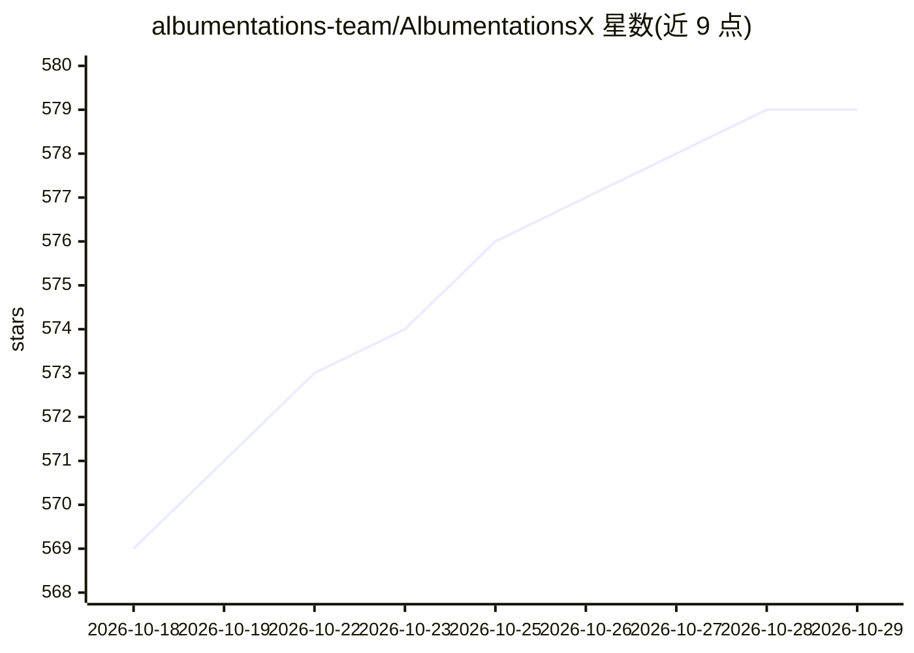

# albumentations-team/AlbumentationsX

⭐ 579 · Python · AGPL-3.0 · 推送 2026-10-26 · [GitHub](https://github.com/albumentations-team/AlbumentationsX) · [官网](https://albumentations.ai/pricing) · 组织维护

**面向计算机视觉训练的 Python 图像增强库**

用于深度学习与计算机视觉训练数据增强的 Python 库：从已有数据生成新训练样本，支持 RGB/灰度/多光谱图像、掩码、边界框（水平/旋转）、关键点及 3D 体积数据的统一 API。提供 70+ 像素级变换、空间级变换、医学影像变换与 3D 变换族，兼容 PyTorch/TensorFlow，属 PyTorch 生态。要求 Python 3.11+，安装前需自行选择 PyTorch 构建（CPU/CUDA/MPS）；默认收集使用统计，可退出。另可通过 MCP 主机供 AI 助手检查与导出流水线。

## 筛选速览

| 维度 | 判定 | 备注 |
|---|---|---|
| AI 角色 | `ai-native` | 本体是模型或模型工具 |
| 许可风险 | `dual` | AGPL-3.0 |
| 部署形态 | `library` | 以包/库形式分发 |
| 模型依赖 | — | README 未给出锁定关系 |
| 硬件要求 | — | 无带数字的原话,不猜 |
| 安装摩擦 | `medium` | 含编译或系统依赖之一 |
| 成熟度 | — | 结构信号不足 |

## 能力要点

- 统一 API 处理图像、掩码、边界框（HBB/OBB）、关键点与 3D 体积
- 70+ 像素级变换及医学影像、3D 专用变换族
- 兼容任意 OpenCV 变体，提供 headless 安装选项
- 社区 MCP 集成：AI 助手可检查变换、验证流水线并导出可复现管线

## 适用场景

- 为目标检测、实例/语义分割训练生成多样化样本
- 医学影像（MRI 伪影、H&E 染色）数据增强
- 3D 体积数据的增强流水线构建
- 让 AI 编程助手检查并导出增强流水线

## 场景标签

`图像视频处理` · 领域:感知与多模态

## 证据(README 行号)

> L14: **AlbumentationsX** is a Python library for image augmentation. It provides high-performance, robust implementation
> L73: - **Deep Learning Integration**: Works with PyTorch, TensorFlow, and other frameworks. Part of the PyTorch ecosyste

## 星数曲线

2026-10-18 569 → 2026-10-29 579（+10）

---
*卡片 v1 · prompt 1.4 · 生成 2026-10-21 · 置信度 high · 依据 README sha `80ad561a9a07` · [字段定义](../../DATASET.md)*
