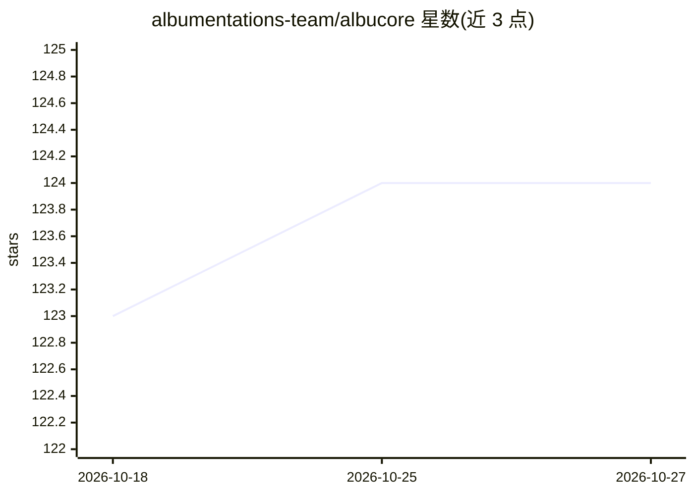

# albumentations-team/albucore

⭐ 124 · Python · MIT · 推送 2026-10-19 · [GitHub](https://github.com/albumentations-team/albucore) · 组织维护

**高性能图像处理原子函数库，为 AlbumentationsX 提供底层算子**

提供优化的原子级图像处理函数（算术、逐元素数学、归一化、统计、LUT、几何/空间变换），作为图像增强库 AlbumentationsX 的基础层。核心机制是根据输入图像的 dtype、尺寸、布局与通道数，将每个操作路由到基准测试选出的 NumPy、OpenCV、NumKong、StringZilla 或 CPU PyTorch 实现。图像路由器支持 uint8/float16/float32（不支持 float64），要求通道维度始终存在。要求 Python 3.11+，安装前需先安装对应 CPU/CUDA/MPS 的 PyTorch 构建，并要求同时具备 OpenCV 与 PyTorch。

## 筛选速览

| 维度 | 判定 | 备注 |
|---|---|---|
| AI 角色 | `ai-ecosystem` | LLM/agent 周边工具 |
| 许可风险 | `permissive` | MIT |
| 部署形态 | `library` | 以包/库形式分发 |
| 模型依赖 | — | README 未给出锁定关系 |
| 硬件要求 | — | 无带数字的原话,不猜 |
| 安装摩擦 | `medium` | 含编译或系统依赖之一 |
| 成熟度 | — | 结构信号不足 |

## 能力要点

- 按输入特征自动路由到最快的 NumPy/OpenCV/NumKong/StringZilla/PyTorch 实现
- 覆盖算术、归一化、统计、LUT、2D/3D 几何变换等原子函数
- 支持 2D 图像与 3D 体数据（含体批次），提供可复现微基准与路由报告
- 与 AlbumentationsX 集成，作为其图像处理基础层

## 适用场景

- 为图像增强流水线（AlbumentationsX）提供高性能底层算子
- 在训练数据预处理中执行 uint8/float16/float32 图像的算术与归一化操作
- 对 3D 体数据（如医学影像）执行仿射、滤波、填充等变换

## 场景标签

`图像视频处理` · 领域:感知与多模态

## 证据(README 行号)

> L7: Albucore is a library of optimized atomic functions designed for efficient image processing. These functions serve a
> L24: Image processing operations can be implemented in several ways, with performance depending on dtype, size, layout, 
> L32: - Seamless integration with AlbumentationsX

## 星数曲线

2026-10-18 123 → 2026-10-27 124（+1）

---
*卡片 v1 · prompt 1.4 · 生成 2026-10-23 · 置信度 high · 依据 README sha `c3465c725dd2` · [字段定义](../../DATASET.md)*
