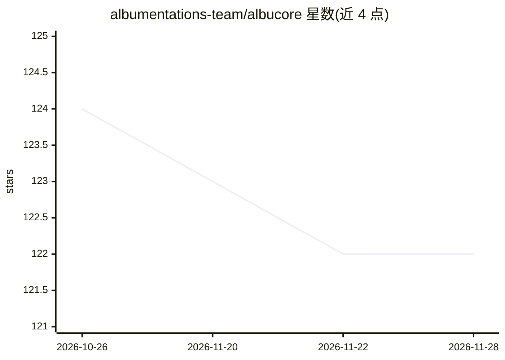

# albumentations-team/albucore

⭐ 122 · Python · MIT · 推送 2026-11-24 · [GitHub](https://github.com/albumentations-team/albucore) · 组织维护

**面向计算机视觉开发者的高性能图像处理原子函数库**

Albucore 提供一组经基准选路的图像处理原子函数（算术、逐元素、归一化、统计、LUT、几何变换、类型转换），按 dtype、尺寸、布局与通道数将每个操作路由到 NumPy、OpenCV、NumKong、StringZilla 或 CPU PyTorch 实现，是 AlbumentationsX 图像增强库的基础层。支持 uint8/float16/float32，提供 out= 复用缓冲区与显式 layout 约定，含 2D 与 3D 体数据（DHWC/CDHW）的仿射、remap 与模糊操作。需 Python 3.11+，依赖 OpenCV 与 PyTorch 运行时。

## 筛选速览

| 维度 | 判定 | 备注 |
|---|---|---|
| AI 角色 | `ai-native` | 本体是模型或模型工具 |
| 许可风险 | `permissive` | MIT |
| 部署形态 | `library` | 以包/库形式分发 |
| 模型依赖 | — | README 未给出锁定关系 |
| 硬件要求 | — | 无带数字的原话,不猜 |
| 安装摩擦 | `medium` | 含编译或系统依赖之一 |
| 成熟度 | — | 结构信号不足 |

## 能力要点

- 按 dtype/布局/尺寸基准选路到 NumPy/OpenCV/NumKong/StringZilla/CPU Torch 实现
- 支持 out= 目标缓冲区复用，无 out 时不写输入存储
- 提供 3D 体数据处理：warp_affine3d、remap3d、gaussian_blur3d、pad3d
- uint8 LUT 路径使用 StringZilla 字节翻译与 cv2.LUT

## 适用场景

- 为计算机视觉数据增强管道提供底层图像操作
- 处理 3D 体数据（如医学影像）的仿射与重采样
- 在数据预处理中批量执行归一化、统计与 LUT 变换

## 场景标签

`图像视频处理` · 领域:感知与多模态

## 证据(README 行号)

> L7: Albucore is a library of optimized atomic functions designed for efficient image processing. These functions serve a
> L24: Image processing operations can be implemented in several ways, with performance depending on dtype, size, layout, 
> L30: **Requires Python 3.11+.** CI covers Python 3.11, 3.12, 3.13, and 3.14. Choose and install the PyTorch build for yo

## 星数曲线

2026-10-26 124 → 2026-11-28 122（-2）

---
*卡片 v1 · prompt 1.4 · 生成 2026-11-28 · 置信度 high · 依据 README sha `1421276213a0` · [字段定义](../../DATASET.md)*
