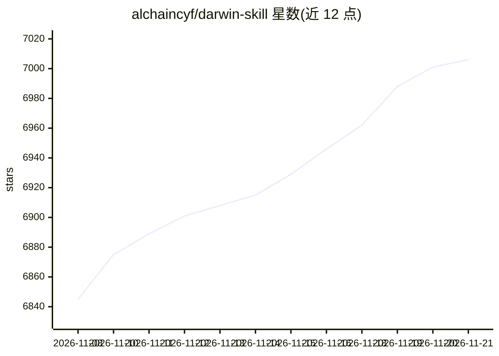

# alchaincyf/darwin-skill

⭐ 7,006 · HTML · MIT · 推送 2026-11-18 · [GitHub](https://github.com/alchaincyf/darwin-skill) · 个人维护 · 中文 README

**面向 Claude Code 等 Agent 的 Skill 自动进化系统：评估→改进→实测→保留或回滚**

受 Karpathy 的 autoresearch 启发，把实验循环从模型训练迁移到 Agent Skill 优化。核心机制：独立子 agent 带新版 skill 实跑任务，三评委盲评新旧产出，脚本按固定规则裁决保留或 git revert 回滚；辅以零 token 体检脚本、9 维诊断评分、开发集/留出集拆分、E0-E3 证据等级报告，并在测试集、基线、进化完成三处设人工检查点。面向拥有大量 Skills 的 skill 作者。限制：每 skill 仅几条测试，只识别大差异；评委仍是 LLM；需能派独立子 agent 的环境。通过 npx skills add 安装，适用于支持 Skill 的 Agent 工具。

## 筛选速览

| 维度 | 判定 | 备注 |
|---|---|---|
| AI 角色 | `ai-ecosystem` | LLM/agent 周边工具 |
| 许可风险 | `permissive` | MIT |
| 部署形态 | `library` | 以包/库形式分发 |
| 模型依赖 | — | README 未给出锁定关系 |
| 硬件要求 | — | 无带数字的原话,不猜 |
| 安装摩擦 | `low` | 无编译、无系统依赖或容器化 |
| 成熟度 | — | 结构信号不足 |

## 能力要点

- 行为棘轮：盲评实跑产出，脚本按固定规则裁决保留或回滚
- darwin.py check 零成本体检（路由、篇幅、文件引用、密钥扫描）
- 平局归短、留出集验收、E0-E3 证据等级报告
- 评估/优化/复测命令化，约 6-20 余次子 agent 调用

## 适用场景

- 我有 60+ 个 skill，需要系统化评估与迭代而非手动维护
- 判断某个 skill 相对裸模型是否真有增益，帮倒忙的先删
- 模型升级后用原测试集复测 skill 是否退化

## 场景标签

`模型评测` `提示工程` · 领域:Agent 开发

## 证据(README 行号)

> L13: 受 Andrej Karpathy 的 autoresearch 启发，把自主实验循环从模型训练搬到 Skill 优化。一个只能向前转的棘轮。
> L63: 传统的 Skill 审查看的是文档：格式对不对、步骤有没有编号、路径能不能访问。但一个格式完美的 Skill，跑出来可能并不比不装它更好。达尔文只认一个判据：装上这个 skill 之后，agent 干同一件活是不是真的更好。
> L164: 安装后在任何支持 Skill 的 Agent 工具里说：

## 星数曲线

2026-11-08 6,845 → 2026-11-21 7,006（+161）

---
*卡片 v1 · prompt 1.4 · 生成 2026-11-17 · 置信度 high · 依据 README sha `b42decd0cdd8` · [字段定义](../../DATASET.md)*
